

  <picture>
    <source media="(prefers-color-scheme: dark)" srcset="services/command-deck/static/brand/sahoshi-lockup.svg">
    
  </picture>

<strong>থামিয়ে নয়, সামলে।</strong> · Not by stopping — by steering.

# Sahoshi — Product Description

**Sahoshi (সাহসী, "brave")** is one live picture of Kolkata's roads, rain and crowds for the traffic police, the
city corporation, disaster response and ambulance crews. The AI proposes, a named officer decides, and citizens hear
the decision in Bengali.

This document describes the product for two readers. **Part A** is for city officials and evaluators: the problem,
who Sahoshi serves, what each screen does, what the AI can and cannot do, the guardrails, the modelled impact, the
cost and the pilot plan. **Part B** is for engineers: the architecture in brief, the honest status of every data
source, and where to go next. The full technical design is [`docs/TECHNICAL_DESIGN.md`](docs/TECHNICAL_DESIGN.md).

---

## Contents

**Part A — The product**

1. [Sahoshi in brief](#1-sahoshi-in-brief)
2. [The Kolkata problems](#2-the-kolkata-problems)
3. [Who it serves](#3-who-it-serves)
4. [Principles and guardrails](#4-principles-and-guardrails)
5. [Journeys](#5-journeys)
6. [The interface, screen by screen](#6-the-interface-screen-by-screen)
7. [The AI, with its honest limits](#7-the-ai-with-its-honest-limits)
8. [Modelled impact](#8-modelled-impact)
9. [Cost, pilot plan and scale](#9-cost-pilot-plan-and-scale)
10. [Roadmap](#10-roadmap)

**Part B — Engineering in brief**

11. [Architecture](#11-architecture)
12. [Honest status](#12-honest-status)
13. [Getting started](#13-getting-started)
14. [Licence and credits](#14-licence-and-credits)
15. [Glossary](#15-glossary)

---

# Part A — The product

## 1. Sahoshi in brief

When a cloudburst meets a high tide, when lakhs of people walk between Durga Puja pandals, when a bus breaks down on
Howrah Bridge, Kolkata's agencies each see one piece of the city. The traffic police watch junctions, KMC watches
pumps and rain, WBSDMA issues alerts, ambulance (108) crews look for a way through, and citizens find out at the
barricade or in the water.

Sahoshi joins those pieces on one screen. It forecasts which roads will choke in the next two hours, which streets
will go under water and how soon, and what a signal-timing change would do across the whole network before anyone
touches a signal. Officers can file a report by speaking Bengali, and camera stills are read for waterlogging,
fallen trees and blocked roads. Every one of these outputs is a **proposal**. A **named duty officer** approves or
rejects it, and if nobody answers, the current plan holds. Approved advisories reach citizens on a public page in
**বাংলা, English and हिंदी**, read aloud in Bengali.

Everything runs on **one on-premises server** beside the control room, with open-source AI and no cloud. It keeps
working when a cyclone cuts the internet. Anything that is not from a live feed says so on screen: EMULATED,
SIMULATED, MODELLED, or "Reference photo · not live".

**Why the name.** সাহসী means brave. The tagline, *থামিয়ে নয়, সামলে।* ("Not by stopping — by steering"),
states the design goal: keep the city moving with targeted, temporary, reversible measures instead of blanket
freezes.

## 2. The Kolkata problems

| Problem | What happens | Source |
|---|---|---|
| **Waterlogging at high tide** | On 22–23 Sep 2025 Kolkata received 251.4 mm at Alipore in the 24 hours to 08:30 IST (251.6 mm as reported by Reuters, the heaviest since 1988), 185.6 mm of it between 02:30 and 05:30, with a peak hour of 98 mm. Roads went under within hours; metro, rail and flights were disrupted days before Durga Puja. PTI reported that nine of the deaths were by electrocution; IANS put the toll at ten. The outfall lock gates were closed from 00:30 to 04:00 because of the Hooghly tide. | IMD RMC Kolkata press release, 23 Sep 2025; Reuters via Dawn, 24 Sep 2025; PTI via The Tribune, 23 Sep 2025; IANS, 23–24 Sep 2025 (links in [`docs/ai/hydro.md`](docs/ai/hydro.md)) |
| **Drainage capacity** | The old network was designed for about 6 mm of rain an hour; the Mayor said in Oct 2024 that it "can only drain 20 mm of water in an hour". | KMC (2015) and the Mayor's statements, cited in [`docs/ai/hydro.md`](docs/ai/hydro.md) |
| **An early-warning system being built** | KMC is building a city Flood Forecasting & Early Warning System (FFEWS), ADB-supported, with sensors in canals, pumping stations and traffic junctions. Its signals are not yet joined to traffic decisions or to the citizen on the road. | ADB, "Toward Resilient Kolkata"; Millennium Post |
| **Durga Puja** | Kolkata Police deploy over 10,000 personnel a day, about 30 % of them on traffic, with ad-hoc one-ways, goods-vehicle restrictions and pandal crowds that spill onto arterials. Ambulance access through the crowds is planned by hand. | Millennium Post, 2025 |
| **Bridge choke-points** | Howrah Bridge carries about 1 lakh vehicles and 1.5 lakh pedestrians a day (approximate). One breakdown on it, on Vidyasagar Setu or at Majerhat cascades across both banks. | Wikipedia; Deccan Herald |
| **Movements and mass events** | VIP movements (Nabanna, Raj Bhavan, the airport), Eden Gardens and Salt Lake stadium egress, Red Road parades, Gangasagar transit via Babughat, the Kolkata Marathon and New Year on Park Street repeatedly take over corridors. | City calendar; [`scripts/scenario_library.json`](scripts/scenario_library.json) |
| **Cyclones** | Amphan (2020), Remal (2024) and Dana (2024) brought tree-falls that blocked arterials; recovery routes change by the hour. | Public record |
| **Ambulances** | Ambulance (108) crews get caught in all of the above. Sahoshi writes it as "ambulance (108)" and claims no partnership with the operator. | Directory listing (not official) |

**The common failure.** The data exists, spread across agencies. What is missing is one shared, trustworthy,
Bengali-first picture that turns it into timely, accountable decisions, and a record of what was proposed, decided
and why.

## 3. Who it serves

| Audience | What they get | Where |
|---|---|---|
| **Kolkata Traffic Police duty officer** (and Bidhannagar and Howrah City Police for their areas) | One queue of decisions, each with its reason, its modelled effect and its labels; plan a movement; file a voice report | The console: Home, Map, Decide, Plan |
| **KMC and WBSDMA control room** | Rain, tide, pumps and waterlogging risk by road with lead times; the 2025 storm replay; advisory drafts in Bengali and English | The console: Home, Map, Advisories |
| **Ambulance (108) crews** | A one-tap corridor request and its status; waterlogging "ambulance windows" | `/driver` (Bengali first) |
| **Citizens** | "Check your road" in বাংলা, English or हिंदी, with a Listen button; no sign-in, no location collected | `/citizen`, `/welcome` |

**What Sahoshi is not.** It does not issue fines, drive signals or dispatch units on its own. It does not identify,
track or describe people. It does not replace agency radio, CAD or the 108 control room. It is a tool for the
officers who already run the city, and it is framed to strengthen their work.

## 4. Principles and guardrails

These rules are enforced in the database schema, the server code and the interface, and tests check them as
behaviour.

| Principle | In practice | Enforced in |
|---|---|---|
| **The AI proposes; a named officer decides** | Every AI output is a proposal (`requires_officer: true`). Approve controls exist only in Decide and the analyst workspace, never on the map, in the assistant, on object pages or on public pages. | The server refuses an unnamed decision (409 or 422); the assistant's tools cannot approve |
| **No answer means the plan holds** | A time-boxed proposal expires after its deadline (90 s by default for escort proposals) and nothing is applied. | convoy-brain; the twin's `if_no_decision: the current plan holds` |
| **Vehicles and places, never people** | No face, person or biometric field exists. Vision refuses "who is in this image" and plate questions before the model runs. Voice has no speaker identification. | Schema; vision query screen and output filter; speech service |
| **Plates masked until an officer is on duty** | Every surface shows `WB06EM•••1` until a named officer is on the console. Exports, share links and saved views stay masked. | The oracle masks every label and text; the deck masks every render |
| **No fine for a theft victim** | Camera reads of a reported-stolen vehicle are evidence only; approving an e-challan on it is refused (409). | Oracle enforcement rules (migration 017) |
| **Honest labels** | EMULATED, SIMULATED, MODELLED, UNVERIFIED-FIELD, UNVERIFIED-CAMERA, NEWS-REPORTED, OFFICIAL-VERIFIED; "Reference photo · not live"; "synthetic voice". | Row-level provenance; UI tags; tests |
| **Events are about places, not people** | OSINT is aggregate: names and ages redacted at parse; a single social post is never surfaced. | osint-ingress, osint-common, oracle ingest guard |
| **Lawful basis and capped retention** | A watchlist entry needs an enumerated lawful basis; retention is capped at 90 days. | Schema CHECK; read-path reaper |
| **Data stays on premises** | No cloud inference; retention limits in the spirit of the DPDP Act, 2023. | Deployment; [`docs/TECHNICAL_DESIGN.md`](docs/TECHNICAL_DESIGN.md) §12 |
| **Respect for public institutions** | Neutral, respectful language about every public body; no party names or symbols. VIP movements are framed as public-safety logistics. | Copy rules; review |

## 5. Journeys

### 5.1 A cloudburst at high tide (control room and duty officer)

1. Past midnight, heavy rain is falling and the Garden Reach tide model shows the next high water within the hour,
   so the outfall gates will shut. The **Rain · Tide** chip on Home reads "Outfall gates shut" when they do.
2. The waterlogging layer turns Rash Behari Avenue (Gariahat) and Ashutosh Mukherjee Road (Hazra) to class 2, deep
   water in about 45 minutes, MODELLED, with each driver labelled.
3. Decide shows the AI proposals: reroute traffic off Hazra via AJC Bose Road; an **ambulance window** note for 108
   crews ("passable for about 45 min more"); a **live-wire hazard** request asking the power utility to inspect
   supply along the road; and one advisory draft in Bengali and English.
4. The duty officer approves the advisory and the live-wire request, and rejects one reroute whose detour is too
   long. Each decision is recorded with the officer's name.
5. Citizens on `/citizen` see "Waterlogging likely at Gariahat crossing" in Bengali and can tap **Listen**.

The **Replay 23 Sep 2025** control shows the same model on the real storm night, with IMD's observed rain, labelled
"Hindsight · not today's city".

### 5.2 Durga Puja, Saptami night (traffic police)

1. The forecast shows Park Circus seven-point crossing reaching V/C 0.81 in 45 minutes (p10–p90 0.72–0.89) on
   Mother Teresa Sarani, "forecast on simulated traffic".
2. Decide offers a pre-emptive diversion via AJC Bose Road → Ashutosh Mukherjee Road → Hazra Road → Syed Amir Ali
   Avenue, and a signal-timing proposal tested in the twin: re-time Park Circus to Webster's cycle for 30 minutes,
   delay −9.0 % at the crossing, cross street −16.7 %, network −0.6 %, confidence medium, MODELLED.
3. The officer approves the diversion and holds the signal change. If nobody had answered, nothing would change.

### 5.3 A field report spoken in Bengali (officer on the ground)

1. A sergeant at Gariahat taps **Report**, holds the button and says "গড়িয়াহাট মোড়ে জল জমেছে, গাড়ি আটকে
   যাচ্ছে।" ("Water has collected at Gariahat crossing; vehicles are getting stuck.")
2. The server reads it in about 1.5 seconds: place **Gariahat crossing**, kind **waterlogging**, severity
   **medium**, with the words that decided it. The audio is not stored.
3. The report goes on the board as **"Field report · unverified"**; a named officer confirms it, and it joins the
   live picture.

### 5.4 A VIP movement from Nabanna to the airport (traffic police)

1. In **Plan**, the officer picks Nabanna → Kolkata Airport and the protection class. Routes come back ranked over
   Vidyasagar Setu, the AJC Bose Road and Maa flyovers, EM Bypass and VIP Road, with times from the traffic twin
   labelled "Simulated traffic".
2. Rolling holds close each junction 60–180 s ahead of the movement and release it as it passes, instead of a
   blanket freeze. The impact model puts the difference at 357,188 against 3,572 commuter-minutes per movement on
   this corridor (MODELLED, §8).
3. A named officer starts and clears the escort; any reroute during the movement is a proposal with a deadline.

### 5.5 A breakdown on Howrah Bridge at the evening surge

The emulator's scenario (SIMULATED) puts a breakdown on Howrah Bridge as Howrah station empties. A camera still of
the bridge, if one is available, is read by vision and enters the queue as UNVERIFIED-CAMERA; the forecast marks
the approach roads likely to cross 0.8; the twin tests candidate timings at the affected crossings against doing
nothing and either proposes one, with its side effects on the cross streets, or answers "hold". The officer decides
each item; until then the current plans hold.

### 5.6 A citizen checks a road

A commuter opens `/citizen` in Bengali, searches "হাজরা", sees the road's status in plain words with its label,
taps **Listen** to hear the approved advisory, and sees the emergency numbers 112 and অ্যাম্বুলেন্স (১০৮). No sign-in
and no location are needed.

## 6. The interface, screen by screen

*Screenshots are in [`docs/screenshots/`](docs/screenshots/); the list of planned files is in its
[`README`](docs/screenshots/README.md). Wireframes of the key screens are in [`docs/wireframes/`](docs/wireframes/).*

The interface is one web console, the **command deck**, at port 5373 of the Sahoshi server. Operator pages use a
dark theme; public pages a light one. Both are neutral black, white and grey, and colour is kept for meaning:
orange for "a named officer must decide", red for danger, green for approved or healthy, blue for a link or for
text the AI wrote. A dashed outline means emulated or unverified. The design rule is *simple by default, deep on
demand*: each screen has one job and one primary action, and every power tool sits one level deeper under
**Analyst**.

### 6.1 Landing (`/welcome`)

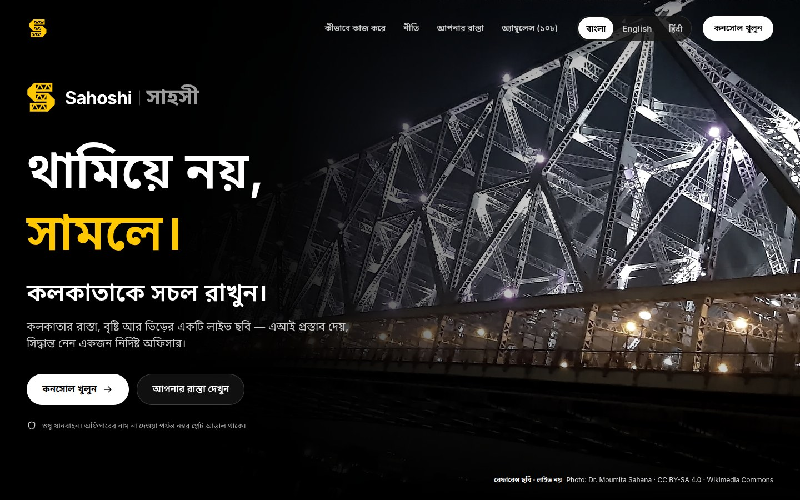

The public front door, Bengali first: the tagline over a credited photograph of Kolkata, the problem with its
modelled figures, the four audiences, the principles, and what Sahoshi is built on with the agencies' and sources'
marks ("marks belong to their owners; not affiliated"). **Open the console** leads to the officer sign-in, **Check
your road** to the citizen page. No API calls.

### 6.2 The shell (every operator page)

- **Left rail:** Home · Map · Decide · Plan · Assistant · Advisories, with **Analyst** below. Decide carries the
  only badge: the number of decisions waiting.
- **Top bar:** one search box for a place, road, event or vehicle mark (`Ctrl K` or `/`); **Report** (the voice
  field report); the language menu (বাংলা · English · हिंदी); the alerts bell with a soft chime; the officer pill.
- **Officer pill:** "Name the duty officer" until someone is named. "Naming yourself shows full registration marks
  on this console and records your name with the decision. Attribution, not sign-in." With the operator PIN set, it
  holds sign-in and sign-out.

### 6.3 Home (`/`)

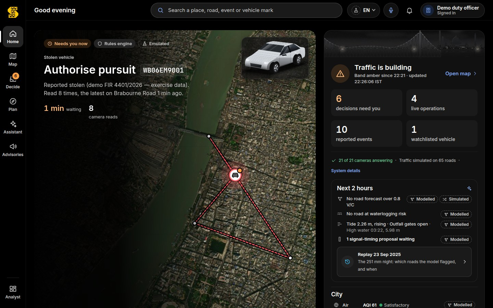

Three questions: what needs me, what is happening, what is coming.

- **Featured decision** with its reason, key figures and one **Review now** button: "It keeps waiting until an
  officer decides."
- **City pulse:** one sentence for the city's state and four counts: decisions waiting, live operations, reported
  events, watchlisted vehicles (plates hidden until an officer is named).
- **Rain · Tide chip:** rain now (LIVE), the tide and whether the outfall gates are open or shut (MODELLED), and the
  number of roads at risk in the next 2 hours.
- **Next 2 hours:** roads forecast to cross 0.8 V/C and roads at waterlogging risk, each with its band and label.
- **Rails of cards:** Needs your decision · Live operations · Reported in the city · Coming up.

### 6.4 Map (`/map`)

| Waterlogging risk | Traffic forecast |
|---|---|
| 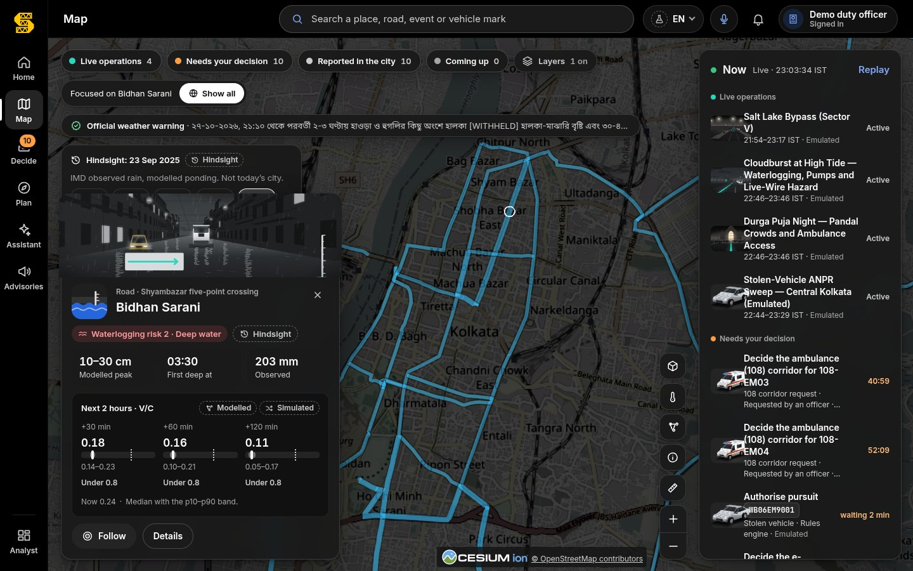 | 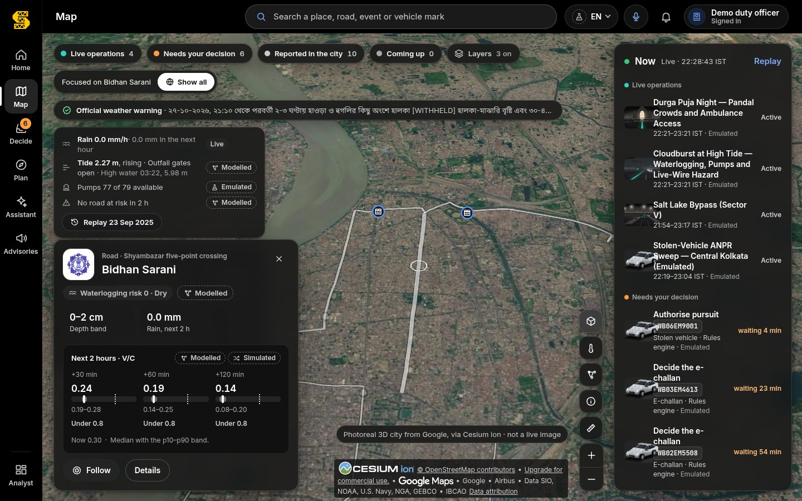 |

- A clean city map (keyless OpenStreetMap, or photoreal 3D through Cesium ion when a key is set, labelled "not a
  live image").
- **Layers:** traffic flow (simulated), **waterlogging risk** 0–3 with lead times (MODELLED), **traffic forecast**
  (roads likely or possibly over 0.8 V/C in 2 hours), cameras at modelled positions, pumping stations (EMULATED),
  events, units and dispatches.
- **Selection card** for any road: its forecast band, its waterlogging class and the four drivers (rain LIVE, tide
  MODELLED, pumps EMULATED, susceptibility MODELLED).
- **Replay 23 Sep 2025:** the storm night on the map, step by step, "IMD observed rain, modelled ponding. Not
  today's city."

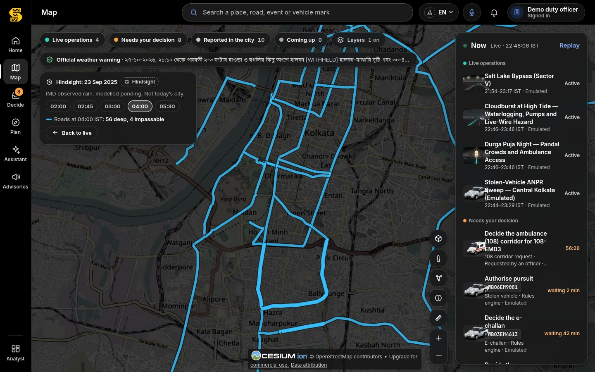

### 6.5 Decide (`/decide`)

| AI signal-timing proposal | Waterlogging proposals |
|---|---|
| 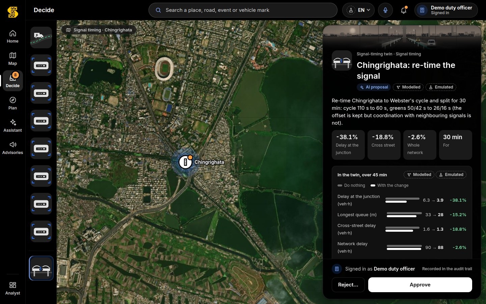 | 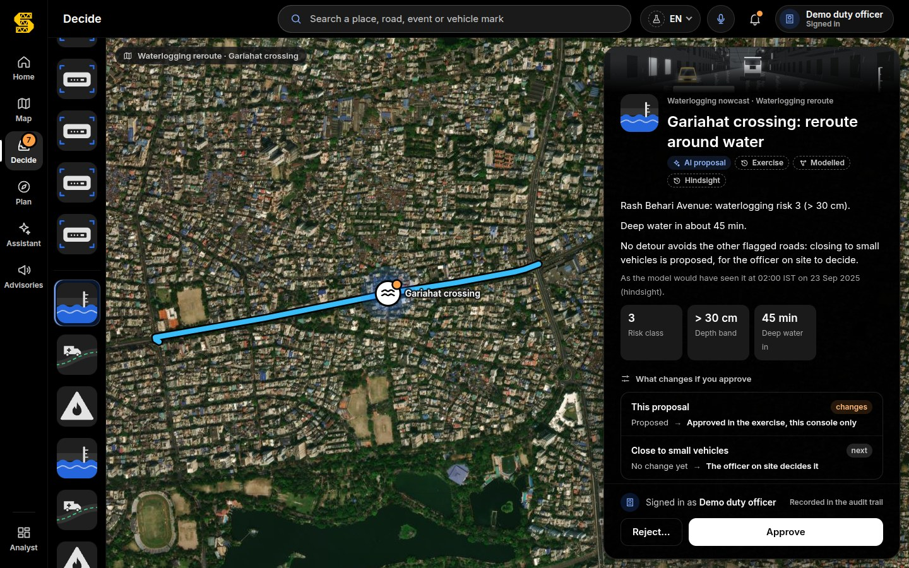 |

One decision at a time, soonest deadline first: the queue on the left, the map of the place in the middle, one
sheet on the right. Every sheet has the same anatomy: what is being decided, why, the key facts with their labels,
**what changes if you approve or reject**, and one primary button that carries the officer's name.

- **AI proposals** ("Forecast, waterlogging and signal timing. You decide each one."):
  - a **signal-timing change** with the twin's comparison against doing nothing: delay at the junction, the longest
    queue, the cross street and the whole network, the confidence and every assumption, and a rationale in English
    and Bengali;
  - a **pre-emptive diversion** from the forecast, with the detour and its length;
  - **waterlogging** proposals: reroute, ambulance window, live-wire hazard request, advisory draft.
- **Platform decisions:** stolen-vehicle sightings ("No fine is ever issued for a stolen vehicle. One approval opens
  one pursuit."),
  e-challan recommendations, time-boxed escort proposals with a countdown ("If no one answers, the current plan is kept."), ambulance (108) corridor requests and decision-support cases.
- Until an officer is named, the buttons are visible but disabled, with the reason. A server refusal is shown in
  the card, in the server's words.

### 6.6 Object pages (`/o/<urn>`)

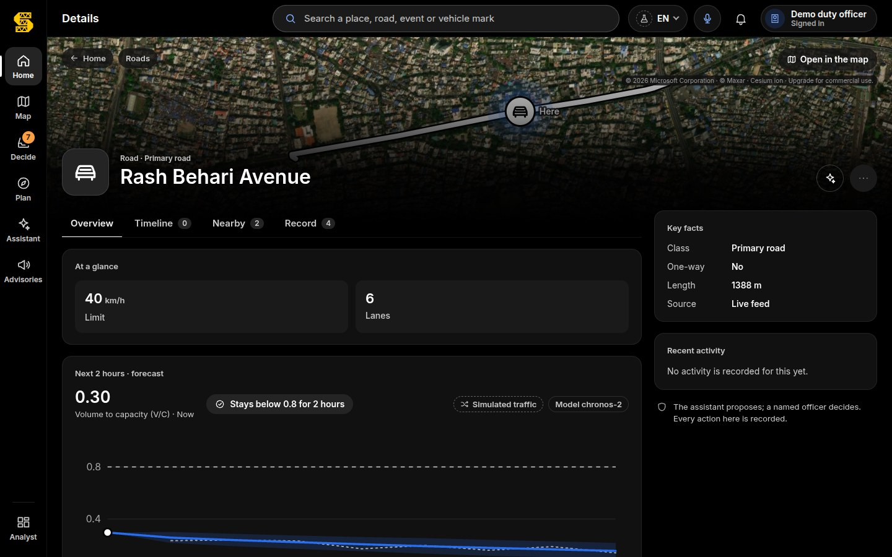

Every record has a page: a road segment, a junction, a corridor event, a reported event, a vehicle, a place, a
camera, a dispatch. A road's page shows its live state, the **forecast band** (median with the p10–p90 band and the
0.8 line), its **waterlogging** class, drivers and replay history, related proposals and the audit trail. A read-only
**Ask about it** panel sends a question to the assistant.

### 6.7 Field report by voice (top bar → **Report**)

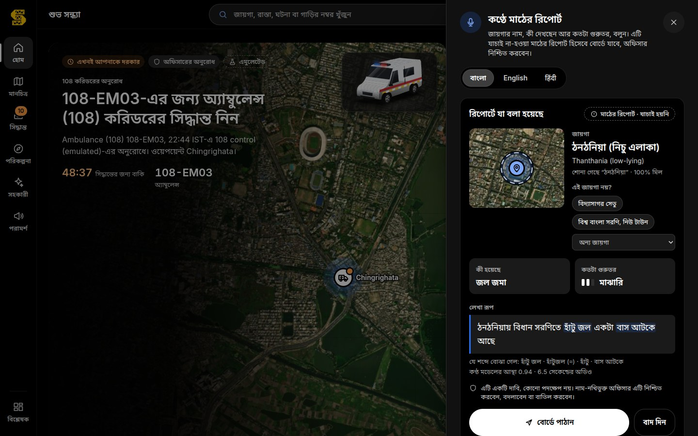

"Press and hold, speak, then let go." The spoken language is Bengali by default (English and Hindi too). The sheet
shows the transcript, the place (with "Not this place?" and the candidates), the kind, the severity and "Words that
decided it". **Send** puts it on the board "as an unverified field report, for an officer to confirm". It can also
be typed. "Audio is not stored. Only the transcript is kept, and no voice is identified."

### 6.8 Camera road state

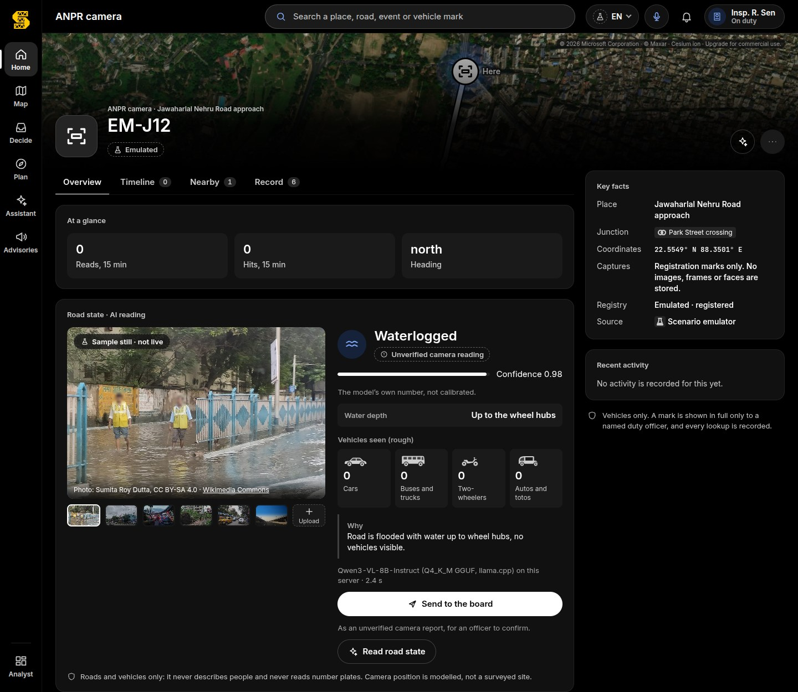

"Road state · AI reading": a still (a sample still is labelled "Sample still · not live"; an uploaded one "Your still,
not stored") is read as waterlogged, blocked, tree fall, stalled vehicle, crash debris, congested or clear, with a
depth band judged against wheels and kerbs. It enters the queue as **unverified** for an officer to confirm.

### 6.9 Plan a movement (`/plan`)

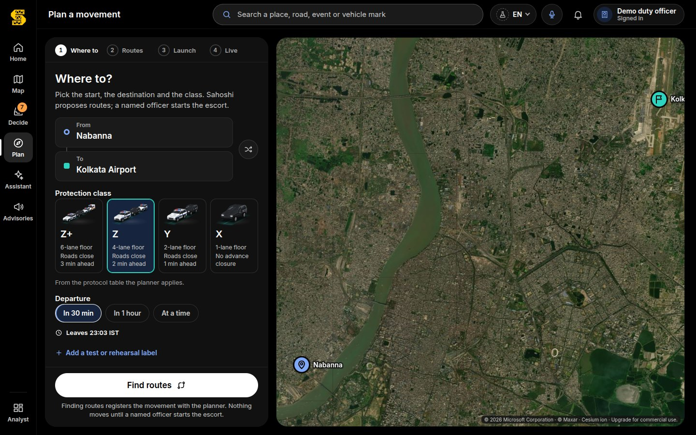

Four steps: **Where to → Routes → Launch → Live**. Routes are ranked with times from the traffic twin, labelled
"Simulated traffic"; launch and clear need a named officer; "Nothing moves until a named officer starts the escort."

### 6.10 Assistant (`/assistant`)

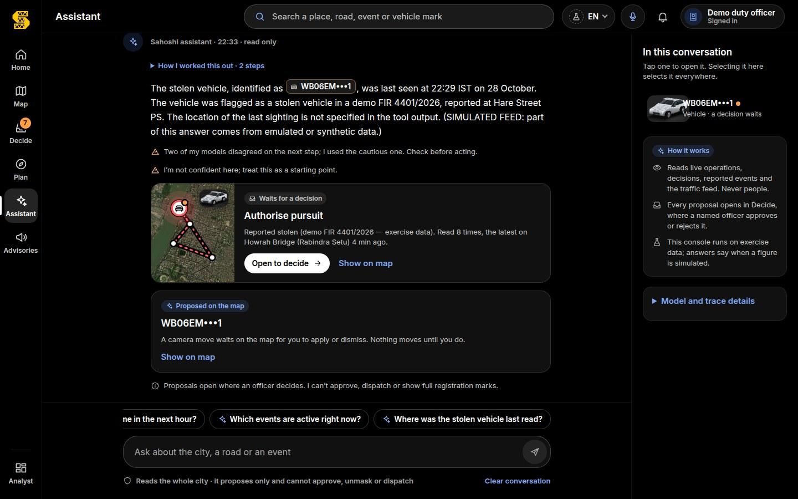

"Ask about the city". The assistant reads live operations, decisions, reported events and
the traffic feed, and **cannot approve, unmask or dispatch**. A proposal arrives as a card that opens in Decide.
Every sentence of an answer is checked against what the tools returned.

### 6.11 Advisories (`/comms`)

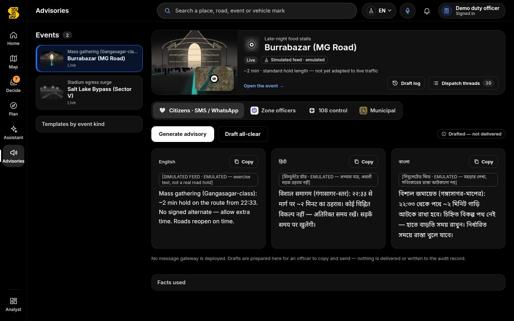

One fact, every audience, three languages: advisory drafts for the public, for crews and for partner agencies, in
বাংলা, English and हिंदी. An officer edits and approves; Sahoshi does not send SMS or social posts on its own.

### 6.12 Analyst (`/analyst`, `/ops`, `/gods-eye`)

| Workspace | Situation wall |
|---|---|
| 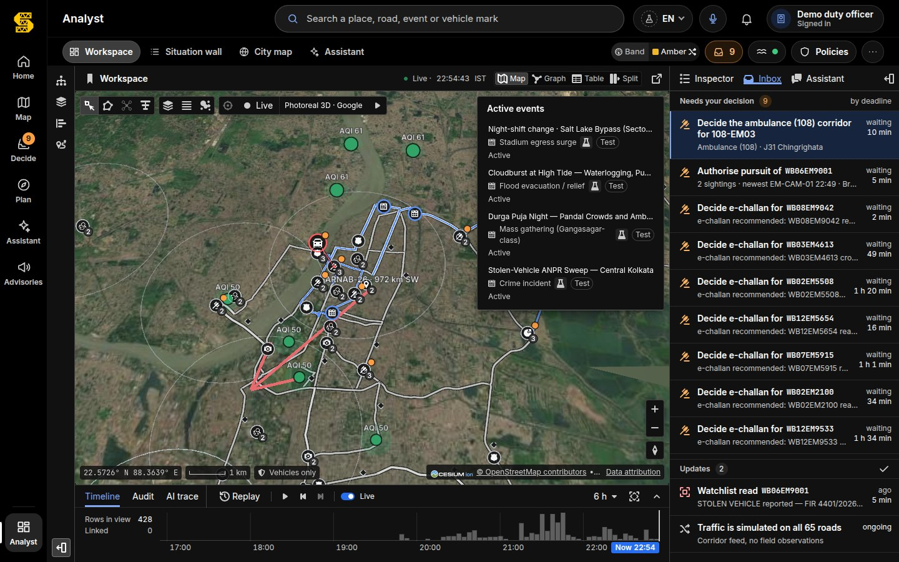 | 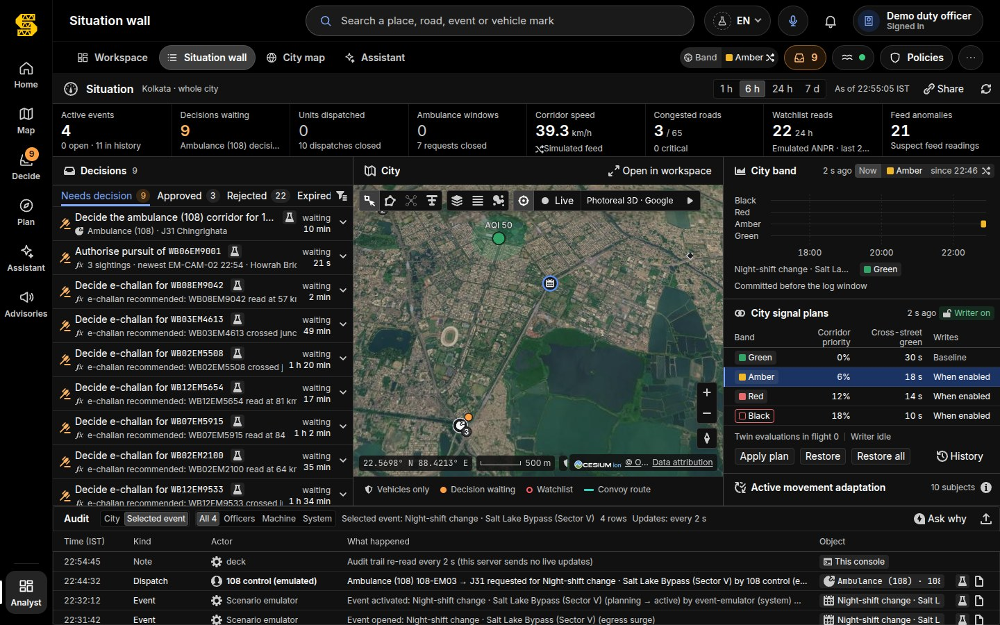 |

The full-density workspace for analysts: tables, filters, saved views (always masked), the situation wall with the
city band and the audit ladder, and the 3D city map.

### 6.13 Public pages: Citizen and ambulance crew

| Citizen (`/citizen`) | Ambulance (108) crew (`/driver`) |
|---|---|
| 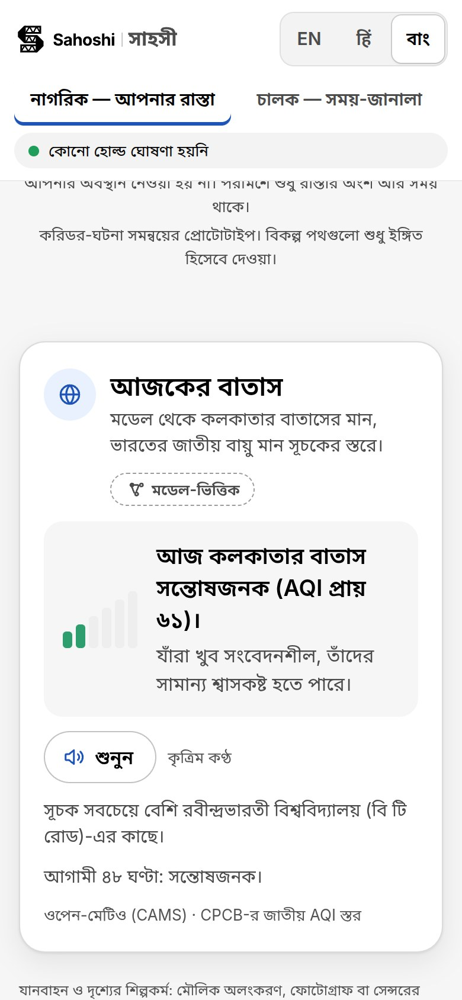 | 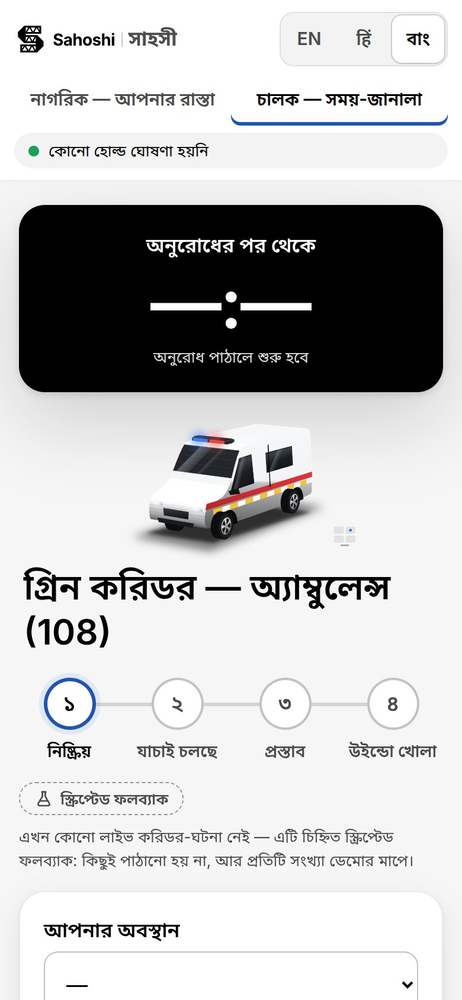 |

- **Citizen:** Bengali by default. Search a road; see approved advisories and the waterlogging status in plain
  words with their labels; **Listen** reads the advisory aloud in Bengali, marked "synthetic voice"; 112 and
  অ্যাম্বুলেন্স (১০৮). No sign-in, no location, no tracking.
- **Ambulance crew:** unit, stretch and urgency; one request button; the status while it waits for a duty officer;
  the line that the crew always follows 108 control.

### 6.14 Languages and accessibility

Every string exists in বাংলা, English and हिंदी; public pages open in Bengali; the console defaults to English
and remembers the reader's choice. Noto Sans Bengali and Noto Sans Devanagari are self-hosted. Bengali copy follows
a glossary (for example প্রস্তাব for "proposal", জল জমা for "waterlogging", মোড় for a named crossing) and uses the
danda (।). Colour is never the only signal: every state also has a word or an icon. Motion respects "reduce
motion".

## 7. The AI, with its honest limits

Every model runs on the one on-premises server. Every output is a proposal or an unverified reading.

| Capability | Model (licence) | What it does | Honest label | Limits |
|---|---|---|---|---|
| **Corridor forecasting** | Chronos-2 (Apache-2.0); TimesFM 2.5 (Apache-2.0) as challenger; seasonal-naive baseline | Speed and V/C for every road, 15–120 min ahead, p10–p90 bands; a diversion proposal when the median crosses 0.8 | "Forecast on simulated traffic" | No real Kolkata traffic history yet; V/C derived from speed; backtest skill (+54.9 % over the baseline) measured on simulated traffic only |
| **Waterlogging nowcast** | No ML: a conceptual ponding model with rain, Hooghly tide, pumps and terrain | Depth-risk class 0–3 per road with lead time; reroute, ambulance window, live-wire request, advisory | rain LIVE, tide MODELLED, pumps EMULATED, risk MODELLED | Rain is a model nowcast (the archive missed the 2025 storm by an order of magnitude); tide is an approximate transfer; 65 arterial roads; not calibrated beyond one event |
| **Bengali voice** | Bengali Whisper-medium fine-tune (Apache-2.0); Whisper large-v3-turbo for English and Hindi (MIT); Svara-TTS v1 (Apache-2.0) with SNAC (MIT) | Spoken report → place, kind, severity; advisories read aloud | UNVERIFIED-FIELD; "synthetic voice" | Evaluated on synthetic audio (CER 2.6 %, place 53/60); real field audio will be harder; TTS slower than real time, so advisories are cached |
| **Road-state vision** | Qwen3-VL-8B-Instruct (Apache-2.0), quantized, on llama.cpp | A camera still → road state, depth band, vehicle estimate | UNVERIFIED-CAMERA | 12-image evaluation (11 correct); confidence is not calibrated; one still cannot tell a stalled bus from one waiting at a signal |
| **Signal-timing proposals** | A cell-transmission traffic twin, with Webster and max-pressure baselines; the local LLM only words the rationale | Tests every candidate timing against doing nothing over the whole network; proposes or holds | MODELLED; demand SIMULATED | Macroscopic; turning ratios assumed; most crossings run template programs; the signal adapter is emulated |
| **Assistant and decision AI** | A 27B decider model asked typed questions; Gemma 4 12B (quantized) for drafting; bge-m3 and pplx-embed for memory | Answers about the live picture; plans movements; checks every claim against tool results | Labels per answer | Cannot approve, unmask or dispatch; Bengali answers are not yet evaluated |
| **Event intelligence (OSINT)** | Rules and fusion, no generative model | Aggregates official alerts and news about places into situations with credibility | UNVERIFIED-OSINT / NEWS-REPORTED / OFFICIAL-VERIFIED | Off by default; aggregate only; credibility measures agreement between sources, not truth |

Details, evaluations and sources: [`docs/ai/forecast.md`](docs/ai/forecast.md),
[`docs/ai/hydro.md`](docs/ai/hydro.md), [`docs/ai/speech.md`](docs/ai/speech.md),
[`docs/ai/vision.md`](docs/ai/vision.md), [`docs/ai/twin.md`](docs/ai/twin.md).

**What was checked against the real world.**

- The tide model is within about 20 minutes of published Garden Reach high waters on 28 Oct 2026, and its modelled
  gate closure on 23 Sep 2025 (00:15–04:30 IST) covers the closure the Mayor reported (00:30–04:00).
- Driven by IMD's observed rain, the waterlogging model flags all 13 places on its network that the news reported
  waterlogged on 23 Sep 2025, the first at 02:45 IST, before the peak hour. Almost the whole city flooded that night,
  so this shows the model is not blind to the event; it does not show fine discrimination.
- Vision passed 9 of 9 policy probes: seven person or plate questions (in English, Bengali and Hindi) were refused,
  and two road questions were answered.

## 8. Modelled impact

All figures are **MODELLED** by [`scripts/impact_run.py`](scripts/impact_run.py) on the Kolkata network; the full
report with its assumptions ledger is [`IMPACT_REPORT.md`](IMPACT_REPORT.md). They are estimates to be replaced
with measured data in a pilot, not field results.

| What is compared | Blanket freeze | Rolling holds |
|---|---|---|
| Hold per junction | 25 min (design range 15–45, an assumption) | 2.5 min (60–180 s activation ahead of the movement) |
| VIP movement corridor, Nabanna → airport (13 junctions, 29 km): commuter-minutes per movement | **357,188** | **3,572** |
| Whole network frozen (upper-bound framing): commuter-minutes per movement | 1,346,322 | 13,463 |
| Vehicles caught in holds (whole network) | 71,804 | 7,180 |
| Fuel idled (whole network) | 12,117 L | 121 L |

- **Reduction:** about 100× in the central case; 25× in the conservative case (15 → 3 min with 40 % fewer arrivals);
  506× in the optimistic case. Delay grows with the square of the hold, which is why shorter holds matter so much.
- **Ambulances:** with 12 ambulance trips assumed to cross a movement corridor per movement-day and 11 minutes
  returned per trip, about 132 minutes per movement-day, about 33,000 a year at 250 movement-days. Each of these is
  an assumption listed in the ledger, to be checked against ambulance (108) dispatch data.
- **Annual, VIP corridor alone:** about 1.47 million commuter-hours (central case).
- **Waterlogging lead time:** in the 2025 replay, deep water was flagged 45–120 minutes ahead (median 90) in a
  hindsight snapshot that treats the observed rain as a perfect nowcast. With a real nowcast the lead will be shorter.

Sahoshi does not claim lives saved. To improve any figure, replace an assumption with measured data and re-run the
script.

## 9. Cost, pilot plan and scale

### 9.1 Cost (estimates, 2026 prices)

| Item | Pilot (one division, 12 months) | Basis |
|---|---|---|
| On-premises AI units (2, one as backup) | ₹8–10 lakh | Desktop-class 128 GB GPU systems at about ₹4–5 lakh each incl. GST |
| Engineering (build, integrate, shadow, support) | ₹29 lakh | 3 engineers × 6 months + 1 engineer × 6 months, about ₹1.2 lakh a month each |
| Water-level sensors at hotspots not covered by FFEWS (optional) | ₹4 lakh | About 20 × ₹20,000 |
| Operator training and SOP workshops | ₹2 lakh | 4 workshops |
| Backup connectivity | ₹0.5 lakh | 4G backup |
| Contingency (15 %) | about ₹6–7 lakh | |
| **Total pilot** | **about ₹45–55 lakh** | |

- **City-wide over two years:** about ₹2–2.5 crore, covering about six nodes (the traffic control room,
  Bidhannagar, Howrah, KMC, WBSDMA and an ambulance hub), a five-person team, about 100 sensors and training.
  Running cost after that: about ₹40–60 lakh a year.
- **Software licences: ₹0.** Sahoshi is MIT; the models are Apache-2.0 or MIT (see §7); maps are OpenStreetMap.
  No per-camera, per-user or cloud fees. Existing CCTV, control rooms and FFEWS sensors are reused, not replaced.

### 9.2 Pilot plan

| Phase | Duration | What happens | Needs |
|---|---|---|---|
| 0. Agreements | 1 month | Data-sharing MoUs; one division chosen; officers nominated | Kolkata Traffic Police, KMC, WBSDMA |
| 1. Shadow mode | 3 months | Sahoshi runs beside the control room; proposals are logged, not acted on; officers rate them | Read access to the FFEWS feed, junction CCTV stills and signal timings for the division |
| 2. Officer-approved live | Through one monsoon and one Durga Puja | Advisories and diversions go live after approval; signal proposals stay advisory until the adapter is certified | Signal controller access for the division; a consented voice recording set |
| 3. Evaluation and scale | 2–3 months | Measured delay, lead times and ambulance minutes against the modelled figures; decide on city-wide roll-out | Measured movement logs; 108 dispatch data |

The first data each phase needs, in order: a rain-gauge feed (KMC FFEWS or IMD AWS), real traffic for the division,
junction CCTV stills, signal timings, and a consented recording set from officers.

### 9.3 Scale: a city is a folder

Everything specific to Kolkata lives in [`cities/kolkata/`](cities/kolkata/): names in three languages, the bbox,
plates, agencies, emergency numbers, landmarks, the curated corridors and the OpenStreetMap extracts. One command,
`python3 scripts/city_build.py <city>`, regenerates every file the services read. A second, reference pack for
another city is kept, and a test builds both.

Per new city: write the pack, build a waterlogging hotspot list and the terrain susceptibility, add spoken place
aliases, and add the local agencies' marks. The services do not change. The next packs named for the region are
**Siliguri, Asansol–Durgapur, Patna and Ranchi**.

## 10. Roadmap

| When | What |
|---|---|
| Now | Kolkata City Pack; forecasting, waterlogging nowcast, Bengali voice, road-state vision, signal-timing twin; console in three languages |
| Pilot, months 1–3 | Wire the FFEWS gauges and pump status into hydro; record real traffic for one division; calibrate the waterlogging model on gauge data; consented voice set and re-evaluation; labelled CCTV still set and confidence calibration |
| Pilot, months 4–12 | Signal adapter for the division's controllers (officer-approved changes only); Bengali and English news OSINT sources (Anandabazar, Ei Samay, Sangbad Pratidin, The Telegraph, TOI Kolkata, Millennium Post RSS), aggregate only; retrieval over SOPs (KP traffic advisories, KMC monsoon plan, WBSDMA cyclone SOP, NDMA guidelines) with citations |
| After the pilot | Regional flood extent from Sentinel-1 SAR (Prithvi-EO-2.0) at district scale after cyclones; the gated Indic speech models (IndicConformer, Indic Parler-TTS) once access is granted; Bengali numerals option on public pages; next City Packs |

---

# Part B — Engineering in brief

## 11. Architecture

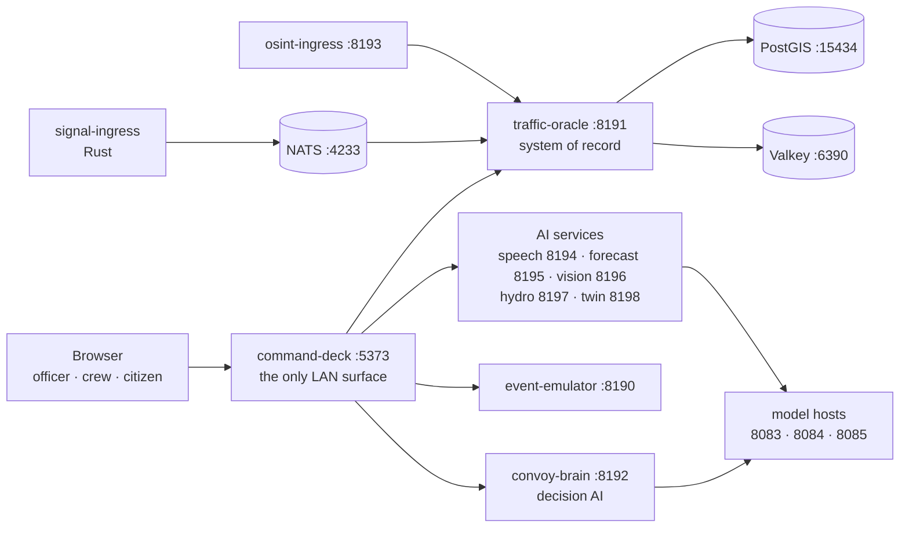

| Layer | Technology |
|---|---|
| Console | SvelteKit (Svelte 5), TypeScript, MapLibre, CesiumJS, served by Bun |
| Platform services | Python 3.12 and FastAPI (oracle, brain, emulator, OSINT, embeddings); Rust (signal-ingress) |
| AI services | FastAPI; PyTorch (Chronos-2, Whisper), llama.cpp (Qwen3-VL, Svara-TTS, the tactical LLM), numpy (the twin) |
| Data | PostgreSQL 16 with PostGIS, pgRouting and pgvector; Valkey; NATS JetStream |
| Deployment | Docker Compose and systemd user units on one arm64 edge server (NVIDIA GB10, 121 GiB unified memory) |

Every service except the deck binds 127.0.0.1. The deck proxies fixed loopback targets, applies the operator gate,
and sets a per-document content-security policy. Details: [`docs/TECHNICAL_DESIGN.md`](docs/TECHNICAL_DESIGN.md).

## 12. Honest status

| Status | What |
|---|---|
| **Real** | The road network (OpenStreetMap), the rain nowcast (Open-Meteo), every decision and its audit trail, the operator gate and masking, the AI models and their outputs, the evaluation results, the reference photographs (credited, labelled not live) |
| **Emulated** (a stand-in for a feed Sahoshi cannot read yet) | The KMC FFEWS pump feed, the traffic feed, ANPR reads, field units, the signal adapter |
| **Simulated** (a scenario) | Durga Puja night, cloudburst at high tide, cyclone recovery, Eden Gardens egress and the other scenarios; forecast history until real traffic is recorded; twin demand |
| **Modelled** (a computed estimate) | The tide at Garden Reach, waterlogging risk, terrain susceptibility, V/C, twin results, camera positions, signal programs, the impact figures |
| **Not connected today** | Agency radio and CAD, SMS and social gateways (advisories are drafts an officer sends), real CCTV feeds, signal controllers |

## 13. Getting started

The quick start, prerequisites and the environment table are in [`README.md`](README.md). Every environment
variable is in [`docs/ENVIRONMENT.md`](docs/ENVIRONMENT.md); sample data and test cases are in
[`docs/SAMPLE_DATA_AND_TESTS.md`](docs/SAMPLE_DATA_AND_TESTS.md).

## 14. Licence and credits

- Code: MIT, © 2026 Sayandeep Haldar ([`LICENSE`](LICENSE)).
- Road data: © OpenStreetMap contributors, ODbL 1.0.
- Terrain: Copernicus DEM GLO-30 (© DLR e.V. 2010–2014 and © Airbus Defence and Space GmbH 2014–2018, provided under
  COPERNICUS by the European Union and ESA).
- Rain: Open-Meteo (CC BY 4.0).
- Tide constants: Khan et al. 2021, *Natural Hazards and Earth System Sciences* 21:2523–2541, Supplement Table S1.
- Reference photographs: Wikimedia Commons works under their own licences, credited on screen and in
  [`services/command-deck/static/photos/NOTICE.md`](services/command-deck/static/photos/NOTICE.md).
- Agency and data-source marks belong to their owners; Sahoshi is not affiliated with or endorsed by them
  ([`services/command-deck/static/logos/NOTICE.md`](services/command-deck/static/logos/NOTICE.md)).
- AI models keep their own licences (§7).

## 15. Glossary

| Term | Meaning |
|---|---|
| City Pack | The folder `cities/<id>/` that holds everything specific to one city |
| V/C | Volume-to-capacity ratio; above about 0.8 a road is near saturation |
| p10–p90 band | The range the forecast expects the value to fall in 8 times out of 10 |
| Twin | A computer model of the road network used to test a change before it is made |
| Rolling hold | A short closure ahead of a movement, released as it passes, instead of a blanket freeze |
| FFEWS | KMC's Flood Forecasting & Early Warning System |
| Outfall gates | Lock gates where the city's drains meet the Hooghly; they close at high tide |
| UNVERIFIED-FIELD / UNVERIFIED-CAMERA | A voice report or a camera reading waiting for an officer's confirmation |
| প্রস্তাব (prostab) | Proposal: every AI output |
| জল জমা (jol joma) | Waterlogging |
| জোয়ার (jowar) | High tide |
| মোড় (mor) | A named crossing, as in গড়িয়াহাট মোড় (Gariahat crossing) |
