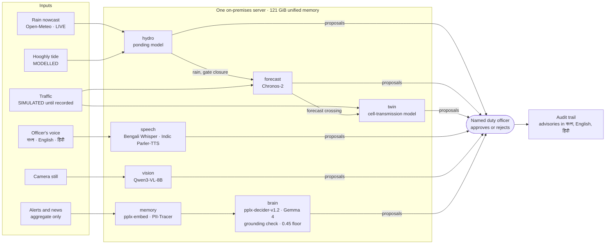
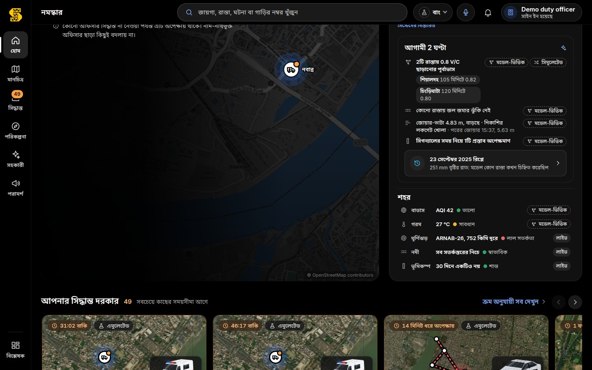
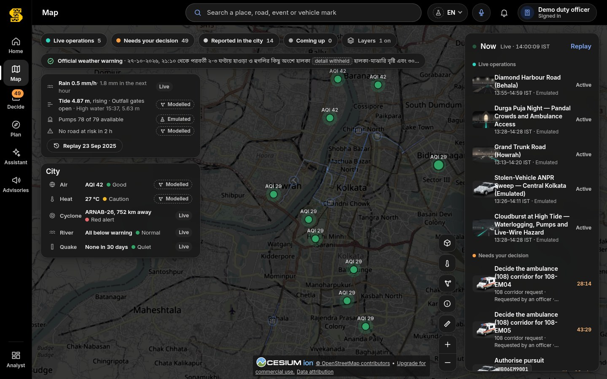
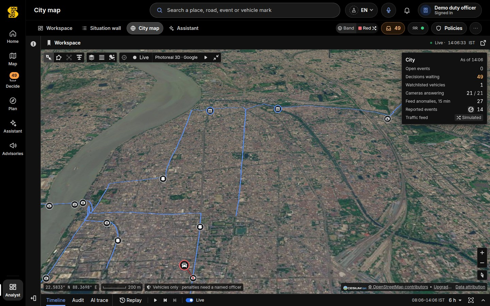
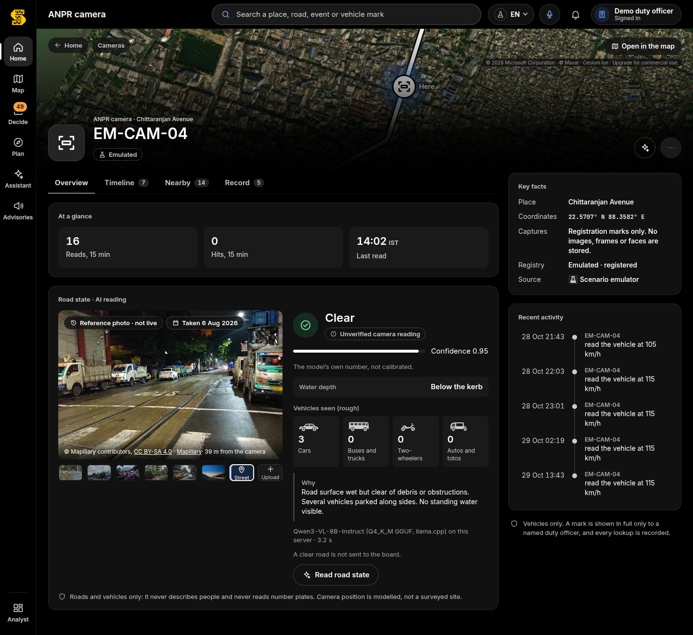
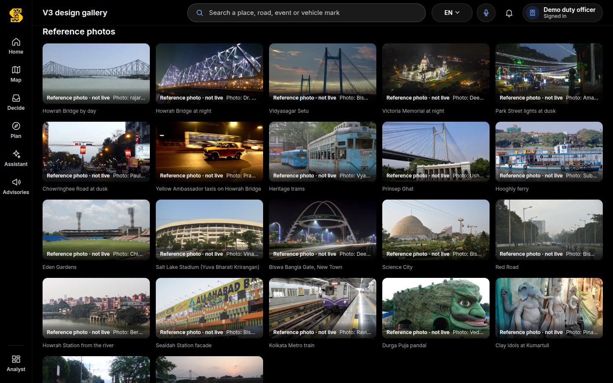

<p align="center">
  <picture>
    <source media="(prefers-color-scheme: dark)" srcset="services/command-deck/static/brand/sahoshi-lockup.svg">
    
  </picture>
</p>

<h3 align="center">থামিয়ে নয়, সামলে।</h3>
<p align="center"><em>Not by stopping — by steering. Keep Kolkata moving.</em></p>

<p align="center">
  <strong>One live picture of Kolkata's roads, rain and crowds for traffic police, the city corporation, disaster
  response and ambulances.<br/>The AI proposes, a named officer decides, and citizens hear it in Bengali.</strong>
</p>

<p align="center">
  
  
  
  
  
</p>

<p align="center">
  
  
  
  
  
</p>

<p align="center">
  
  
  
  
  
  
  
</p>

<p align="center">
  
</p>

<p align="center">
  <a href="#what-sahoshi-is">What it is</a> ·
  <a href="#for-reviewers">For reviewers</a> ·
  <a href="#the-ai-stack">AI stack</a> ·
  <a href="#state-of-the-art-open-and-on-premises">State of the art</a> ·
  <a href="#the-screens">Screens</a> ·
  <a href="#quick-start">Quick start</a> ·
  <a href="#environment-variables">Environment</a> ·
  <a href="#the-city-pack-a-city-is-a-folder">City Pack</a> ·
  <a href="#tests">Tests</a> ·
  <a href="#documentation">Docs</a> ·
  <a href="#licence-and-credits">Licence</a>
</p>

---

## What Sahoshi is

**Sahoshi (সাহসী, "brave")** is a city-scale traffic, rain and crowd operations platform for Kolkata.

When a cloudburst meets a high tide on the Hooghly, when lakhs of people walk between Durga Puja pandals, or when a
bus breaks down on Howrah Bridge, each agency sees one piece of the city. Sahoshi puts the pieces on one screen:

- **Waterlogging, ahead of time.** Rain, the Hooghly tide (which shuts the outfall gates), pump status and terrain,
  combined into a depth-risk class for every arterial road with a lead time. Driven by IMD's observed rain for the
  22–23 Sep 2025 storm, it flagged every on-network place the news reported waterlogged.
- **Traffic, two hours ahead.** Forecasts with uncertainty bands for every road, and a pre-emptive diversion
  proposal when a road is about to choke.
- **Signal timing, tested before it is touched.** Every proposed change is simulated across the whole network
  against doing nothing; if it would only move the jam, the answer is "hold".
- **Bengali voice.** An officer speaks a report in Bengali and it becomes a structured, unverified field report.
  Advisories are read aloud to citizens in Bengali.
- **Camera stills, read for the road.** Waterlogged, blocked, tree fall, stalled vehicle: vehicles and roads only,
  never people.

Every output is a **proposal**. A **named duty officer** approves or rejects it; if nobody answers, the current plan
holds. Everything runs on **one on-premises server** with open-source AI and no cloud, so it keeps working when a
cyclone cuts the internet. Anything that is not from a live feed says so: **EMULATED**, **SIMULATED**,
**MODELLED**, or "Reference photo · not live".

**Where it stands today.** Sahoshi is a working prototype on one server. Roads (OpenStreetMap), the rain nowcast,
every decision and its audit trail, and the AI models are real. **Traffic is simulated until real Kolkata traffic is
recorded**; pumps, signal controllers and ANPR reads are emulated stand-ins for feeds that need an agency's access.
The full list is in [PRODUCT.md §12](PRODUCT.md#12-honest-status).

### Who it serves

| Audience | What they get |
|---|---|
| **Kolkata Traffic Police duty officer** (Bidhannagar and Howrah City Police for their areas) | One queue of decisions, each with its reason, its modelled effect and its labels; movement planning; voice reports |
| **KMC and WBSDMA control room** | Rain, tide, pumps and waterlogging risk by road, with lead times and advisory drafts in Bengali and English |
| **Ambulance (108) crews** | A one-tap corridor request and "ambulance windows" through waterlogged roads |
| **Citizens** | "Check your road" in বাংলা, English or हिंदी, with a Listen button; no sign-in, no location |

The full product description, with the Kolkata problems and their sources, the journeys, every screen, the modelled
impact, the cost and the pilot plan, is [`PRODUCT.md`](PRODUCT.md).

---

## For reviewers

Sahoshi is entered in the **Seva First Innovation Challenge 2026, Eastern Region** (Department of Science &
Technology and Biotechnology, Government of West Bengal). This repository is the supporting evidence. The two tables
below point each heading of the proposal, and each criterion the jury may consider, to the place in this repository
where it is answered.

**The ten proposal headings**

| # | Heading | In one line | Evidence in this repository |
|---|---|---|---|
| 1 | Problem & Location | Kolkata: waterlogging when heavy rain meets a high tide on the Hooghly (251.4 mm at Alipore on 22–23 Sep 2025), Durga Puja crowds, bridge choke-points, VIP movements, cyclones | [PRODUCT §2](PRODUCT.md#2-the-kolkata-problems) (each problem with its source); [the 2025 storm and its sources](docs/ai/hydro.md#replay-2223-september-2025) |
| 2 | Proposed Solution | One live picture for police, KMC, WBSDMA, ambulance crews and citizens; the AI proposes, a named officer decides | [What Sahoshi is](#what-sahoshi-is); [PRODUCT §1](PRODUCT.md#1-sahoshi-in-brief), [§5 Journeys](PRODUCT.md#5-journeys), [§6 every screen](PRODUCT.md#6-the-interface-screen-by-screen); [the screens](#the-screens) |
| 3 | Technology or Method | Open AI models and physical models on one on-premises server, each chosen by measurement | [The AI stack](#the-ai-stack); [State of the art](#state-of-the-art-open-and-on-premises); [Technical design](docs/TECHNICAL_DESIGN.md) ([§5 AI services](docs/TECHNICAL_DESIGN.md#5-the-ai-services), [§17 decisions](docs/TECHNICAL_DESIGN.md#17-architecture-decision-records)); [`docs/ai/`](docs/ai/) |
| 4 | Implementation Plan | Agreements → 3 months in shadow mode → officer-approved live through one monsoon and one Durga Puja → evaluation; the data each phase needs, in order | [PRODUCT §9.2 Pilot plan](PRODUCT.md#92-pilot-plan); [Quick start](#quick-start); [deployment](docs/TECHNICAL_DESIGN.md#3-containers-ports-and-deployment); [data sources: live, keyed or simulated](docs/DATA_SOURCES.md) |
| 5 | Cost & Funding | Pilot for one division, 12 months: about ₹45–55 lakh; city-wide over two years about ₹2–2.5 crore; ₹0 software licences | [PRODUCT §9.1 Cost](PRODUCT.md#91-cost-estimates-2026-prices) (every line with its basis) |
| 6 | Beneficiaries | Officers of Kolkata Traffic Police, Bidhannagar and Howrah City Police, KMC and WBSDMA control rooms, ambulance (108) crews; residents of the KMC area (about 45 lakh) and the urban agglomeration (about 1.41 crore, Census 2011) | [PRODUCT §3](PRODUCT.md#3-who-it-serves); population in [`cities/kolkata/city.json`](cities/kolkata/city.json) |
| 7 | Timeline | Prototype running now; pilot about 12 months; roadmap by quarter | [PRODUCT §9.2](PRODUCT.md#92-pilot-plan), [§10 Roadmap](PRODUCT.md#10-roadmap) |
| 8 | Expected Impact | MODELLED: about 100× fewer commuter-minutes per VIP movement with rolling holds (357,188 → 3,572 on Nabanna → airport); deep water flagged 45–120 min ahead in a hindsight run of the 2025 storm | [PRODUCT §8](PRODUCT.md#8-modelled-impact); [`IMPACT_REPORT.md`](IMPACT_REPORT.md) with its assumptions ledger |
| 9 | Scalability | A city is a folder: a new district is a new City Pack and one build; next packs Siliguri, Asansol–Durgapur, Patna, Ranchi | [PRODUCT §9.3](PRODUCT.md#93-scale-a-city-is-a-folder); [The City Pack](#the-city-pack-a-city-is-a-folder); [design §6](docs/TECHNICAL_DESIGN.md#6-the-city-pack), [§15](docs/TECHNICAL_DESIGN.md#15-deployment-and-capacity) |
| 10 | Prototype or Pilot (with evidence) | A running prototype: 22 screenshots, 6,212 Python and 121 Rust tests green, evaluations with their raw results, a replay of the 2025 storm | [The screens](#the-screens); [tests and 48 test cases](docs/SAMPLE_DATA_AND_TESTS.md); [evidence PDF](docs/evidence/Sahoshi_Evidence.pdf); [deck](docs/deck/Sahoshi_Deck.pdf); [sample API answers](docs/samples/) |

**The jury's criteria**

| Criterion | Evidence |
|---|---|
| Problem relevance | Sourced Kolkata problems ([PRODUCT §2](PRODUCT.md#2-the-kolkata-problems)); the model replayed on the real 22–23 Sep 2025 storm ([hydro](docs/ai/hydro.md#replay-2223-september-2025)) |
| Originality | Tide-aware waterlogging nowcast; every signal change tested in a traffic twin before an officer sees it; Bengali voice in and out; newest open models chosen by measurement ([State of the art](#state-of-the-art-open-and-on-premises); [15 design decisions](docs/TECHNICAL_DESIGN.md#17-architecture-decision-records)) |
| Practicality | Reuses existing CCTV, control rooms and KMC's FFEWS sensors; one server beside the control room; works offline in a cyclone ([PRODUCT §4](PRODUCT.md#4-principles-and-guardrails), [§9.1](PRODUCT.md#91-cost-estimates-2026-prices)) |
| Technical feasibility | Built and running: 68 automated gates green on 29 Oct 2026 ([Tests](#tests)); measured AI results ([`docs/ai/`](docs/ai/)); [technical design](docs/TECHNICAL_DESIGN.md) |
| Cost | Pilot about ₹45–55 lakh; running cost after scale-up about ₹40–60 lakh a year; no per-camera, per-user or cloud fees ([PRODUCT §9.1](PRODUCT.md#91-cost-estimates-2026-prices)) |
| Implementation feasibility | A phased pilot with named data needs ([PRODUCT §9.2](PRODUCT.md#92-pilot-plan)); every outside source marked live, keyed or simulated ([`DATA_SOURCES.md`](docs/DATA_SOURCES.md)); every setting documented ([`ENVIRONMENT.md`](docs/ENVIRONMENT.md)) |
| Expected impact | MODELLED, with every assumption listed and a script to re-run ([PRODUCT §8](PRODUCT.md#8-modelled-impact), [`IMPACT_REPORT.md`](IMPACT_REPORT.md)); no claim of lives saved |
| Sustainability | Open models on owned hardware, MIT code, no data leaves the server; a named officer accountable for every action; honest labels ([ADR-01](docs/TECHNICAL_DESIGN.md#adr-01--all-ai-runs-on-premises), [ADR-09](docs/TECHNICAL_DESIGN.md#adr-09--the-ai-proposes-a-named-officer-decides-no-answer-means-the-plan-holds)) |
| Scalability | City Pack plus `scripts/city_build.py`; a test builds two cities ([PRODUCT §9.3](PRODUCT.md#93-scale-a-city-is-a-folder)) |
| Evidence quality | Every figure carries its date and source; raw evaluation files are committed (for example [`services/speech/eval/results.json`](services/speech/eval/results.json), [`services/vision/eval/results.json`](services/vision/eval/results.json)); limits stated ([design §18](docs/TECHNICAL_DESIGN.md#18-known-limitations), [known gaps](docs/SAMPLE_DATA_AND_TESTS.md#part-4--known-gaps)) |

---

## The AI stack

Every model runs on the one on-premises server. The operator downloads the weights once and they are served
offline; none is in this repository.

| Capability | Model | Licence | What it does | Honest label |
|---|---|---|---|---|
| Corridor forecasting | **Chronos-2** (`amazon/chronos-2`); TimesFM 2.5 as challenger; seasonal-naive baseline | Apache-2.0 | Speed and V/C for every road 15–120 min ahead with p10–p90 bands; a diversion proposal when the median crosses 0.8 | "Forecast on simulated traffic" until real Kolkata traffic is recorded |
| Waterlogging nowcast | No ML: a conceptual ponding model (rain × tide × pumps × terrain) | — | Depth-risk class 0–3 per road with lead time; reroute, ambulance window, live-wire request, Bengali and English advisory | rain LIVE · tide MODELLED · pumps EMULATED · risk MODELLED |
| Bengali speech recognition | `bengaliAI/tugstugi_bengaliai-asr_whisper-medium`; `openai/whisper-large-v3-turbo` for English and Hindi | Apache-2.0; MIT | A spoken field report → place, kind, severity | UNVERIFIED-FIELD until an officer confirms |
| Bengali speech synthesis | AI4Bharat Indic Parler-TTS (`ai4bharat/indic-parler-tts`); Svara-TTS v1 with the SNAC 24 kHz codec answers while it cannot load | Apache-2.0; Apache-2.0 and MIT | Advisories read aloud in Bengali, English or Hindi | "Synthetic voice" |
| Road-state vision | **Qwen3-VL-8B-Instruct** (Q4_K_M GGUF on llama.cpp) | Apache-2.0 | A camera still → waterlogged, blocked, tree fall, stalled vehicle, crash debris, congested or clear | UNVERIFIED-CAMERA; person and plate questions refused |
| Signal-timing proposals | A cell-transmission traffic twin with Webster and max-pressure baselines; the local LLM only words the rationale | — | Tests each candidate timing against doing nothing over the whole network | MODELLED; demand SIMULATED |
| Assistant and decision AI | A 27B decider model (`pplx-decider-v1.2`) asked typed questions; a Gemma 4 12B fine-tune (Q4_K_M) for drafting; `pplx-embed-context-v1-4b` and `pplx-embed-v2-late-0.6b` for memory, `PII-Tracer` for personal details in news | Apache-2.0 (decider, Gemma 4), MIT (embeddings, PII-Tracer) | Answers about the live picture, plans movements, checks every claim against tool results | Labels per answer; cannot approve |

How each model was chosen, evaluated and limited: [`docs/ai/`](docs/ai/). Licences and attributions for everything
third-party: [`THIRD_PARTY_NOTICES.md`](THIRD_PARTY_NOTICES.md).

---

## State of the art, open and on premises

Sahoshi uses the newest open models that fit on one server beside the control room, and adopts each one only after
measuring it on Kolkata data against what it would replace. Nothing is sent to a cloud service. The results below
are Sahoshi's own measurements; where the data is synthetic or simulated, the row says so.



### Models

| Model | Released¹ | What is new in it | How Sahoshi uses it | Measured on Sahoshi's data |
|---|---|---|---|---|
| **Chronos-2** (Amazon) | Oct 2025 | A forecasting foundation model (about 120 M parameters) that forecasts series it was never trained on (zero-shot) and takes known future covariates | Speed and V/C for 65 roads, 15–120 min ahead, p10/p50/p90; rain, outfall-gate closure and events as covariates; a diversion proposal when the median crosses 0.8 | MAE 0.0429 V/C against 0.0952 for the seasonal baseline (+54.9 % skill); p10–p90 coverage 0.797 (target 0.80); 780 series. **On simulated traffic** ([forecast](docs/ai/forecast.md#backtest)) |
| **TimesFM 2.5** (Google), challenger | Sep 2025 | A 200 M-parameter zero-shot forecaster | Run beside Chronos-2 in every backtest | MAE 0.0443, coverage 0.813, +53.5 % skill (univariate: its covariate path needs JAX) |
| **Qwen3-VL-8B-Instruct** (Qwen) | Oct 2025 | An open vision-language model that reads a scene at 8 B parameters | Reads a camera still as a road state with a depth band judged against wheels and kerbs; Q4_K_M on llama.cpp with JSON-schema-constrained output | 11 of 12 credited photos right; all 7 person and plate questions refused (English, Bengali, Hindi) and both road questions answered; 3.0 s warm; 7.6 GiB ([vision](docs/ai/vision.md#evaluation-28-oct-2026-real-model)) |
| **Indic Parler-TTS** (AI4Bharat) | Oct 2024 | Open speech synthesis for Indian languages, the voice set by a plain-text description | Reads approved advisories aloud in Bengali, English and Hindi, every voice levelled to one loudness; live since 29 Oct 2026 | Round trip through the Bengali ASR: WER 8.2 % against 11.2 % for Svara, places 60/60 against 55/60, 3.5 s per clip against 6.8 s; advisories approved by a listener ([speech](docs/ai/speech.md#the-29-oct-gated-round-indicconformer-and-indic-parler-tts)) |
| **Svara-TTS v1**, fallback | Oct 2025 | One open model for Bengali, Hindi and English, male and female voices | Answers whenever Parler cannot load; Q8_0 GGUF on llama.cpp | 6.8 s per short advisory on llama.cpp against 16.5 s on transformers |
| **Bengali Whisper-medium** (Bengali.AI fine-tune) | Jun 2024 | Whisper fine-tuned for Bengali speech | Turns an officer's spoken Bengali report into place, kind and severity, always UNVERIFIED-FIELD | Lowest error of 8 checkpoints measured: WER 11.2 %, CER 2.5 %, kind 60/60, place 55/60; 1.29 s per report. **Synthetic audio** ([speech](docs/ai/speech.md#evaluation)) |
| **whisper-large-v3-turbo** (OpenAI) | Oct 2024 | A faster large Whisper (0.81 B) | English and Hindi reports, and language detection | Never given Bengali: it wrote 48 of 60 Bengali clips partly or wholly in Devanagari |
| **pplx-decider-v1.2** (Perplexity) | Oct 2026 | A 27 B fine-tune of Qwen that answers **typed questions** (a choice, a probability, a score) with calibrated confidence, every question of a request read in one pass | The brain's strategic tier: courses of action, checkpoints, tool choice; its answers are proposals | 22 of 26 labelled Kolkata decisions; p50/p95 739/1,048 ms against 1,292/2,098 ms for v1-27b; share held back for an officer 0.43 against 0.60 ([decider](docs/ai/decider.md)) |
| **Gemma 4 12B** (Google), tuned | May 2026 | Google's open 12 B model, now under Apache-2.0 (Gemma 3 was under Google's own terms) | The tactical tier: drafts tool arguments against each tool's schema and words answers and the twin's rationales | 7.3 GiB resident (Q4_K_M, 2 × 8k slots); English and Bengali rationale in about 7 s, every number checked against the twin |
| **pplx-embed-context-v1-4b** (Perplexity) | Jan 2026 | Contextual (late-chunking) embeddings, cut to 1,024 values (Matryoshka) | Finds the SOP paragraph that answers a Bengali or English question; clusters Bengali and English headlines about one event | SOP recall@1 0.94 against 0.70 for bge-m3 (Bengali 0.93 against 0.71); headline dedup F1 0.86 against 0.26 at the existing threshold. **Synthetic Kolkata set** ([embeddings](docs/ai/embeddings.md#results)) |
| **pplx-embed-v2-late-0.6b** (Perplexity) | Aug 2026 | Late-interaction (ColBERT-style) embeddings, 128 values per token | Decision memory: "have we seen this situation before?" before the brain trusts a confident answer | Memory recall@1 0.98; the brain's novelty and cache floors are calibrated on its scale |
| **PII-Tracer** (Perplexity) | Jul 2026 | A ~600 M bidirectional encoder that tags personal details in text | A second check on news text, after the rules: names are redacted, places kept | Person recall 0.84 → 0.94 added to the rules; 0 of 122 place names redacted. Off by default ([PII-Tracer](docs/ai/embeddings.md#pii-tracer-parse-time-pii-check-defence-in-depth)) |

¹ The month the model's Hugging Face repository was created, read from the Hub on 29 Oct 2026.

### Methods

| Method | What it is | How Sahoshi uses it | Measured |
|---|---|---|---|
| **Several models on one GPU, loaded on demand** | Resident models stay loaded; the rest load on first use, unload when idle and refuse to start below a memory floor | The decider (about 49 GiB), the tactical LLM (7.3 GiB) and the embeddings (11.0 GiB reserved) stay resident; Chronos-2, vision and speech load when asked and unload after 10 idle minutes; a 503 instead of a risk to the resident models ([design §15.2](docs/TECHNICAL_DESIGN.md#152-memory-budget-measured-on-the-reference-box)) | Chronos-2 loads in 6–12 s and frees itself after the idle timer (32 MiB left allocated); the Bengali TTS worker loads in about 35 s, then about 7 s per advisory |
| **Q4_K_M GGUF quantisation on llama.cpp** | 4-bit weights served by `llama-server` on loopback | Qwen3-VL-8B (with an F16 projector), the Gemma 4 12B tactical model; Svara at Q8_0 | Vision in 7.6 GiB at 11/12; TTS 2.4× faster than transformers on the same box ([ADR-13](docs/TECHNICAL_DESIGN.md#adr-13--llamacpp-for-the-vision-model-and-tts)) |
| **Quantile forecasts (p10–p90 bands)** | The forecast is a band the value should fall in 8 times out of 10, not one number | Every road's page and the map show the median with its band against the 0.8 V/C line; the trigger uses the median | Coverage 0.797 against the 0.80 target; bands half as wide as the baseline's (0.135 against 0.276). Simulated traffic |
| **A cell-transmission traffic twin, with Webster and max-pressure baselines** | Daganzo's macroscopic model of queues and spill-back over the whole network | Every signal-timing candidate runs for 30–60 min against doing nothing; a candidate that raises network delay, adds spill-back or pushes the cross street up by more than 25 % is rejected; "hold" is a valid answer ([twin](docs/ai/twin.md)) | Shock speed within 0.2 % of theory and bottleneck discharge exact; 30 min of the network (5,979 cells) in 0.12 s, 20 candidates in 0.85 s on the CPU; a green wave that cut corridor delay 18.7 % was rejected because network delay rose 0.4 % |
| **A physics-style ponding nowcast, checked against the 22–23 Sep 2025 storm** | A bucket model per road: rain in, drainage out, capacity halved while the tide shuts the outfall gates, terrain from Copernicus DEM | Depth-risk class and lead time for 65 roads; reroute, ambulance window, live-wire and advisory proposals ([hydro](docs/ai/hydro.md)) | On IMD's observed rain: 13 of 13 reported on-network places flagged, the first at 02:45 IST, before the 03:00–04:00 peak hour; modelled gate closure 00:15–04:30 IST against 00:30–04:00 reported. Almost the whole city flooded, so this shows the model is not blind, not fine discrimination; reanalysis rain (20.5 mm against 248.8 mm measured) flags nothing, which is why gauges come first in the pilot |
| **Tool-grounded claim checking** | Code, not the prompt, decides what an answer may state | Before a tool runs, its arguments must come from the officer, the session or an earlier tool result; after the answer is written, every sentence that names a place, figure, time or vehicle no tool returned is removed and counted. The twin's rationale is rejected if it carries a number not in the metrics or a stray script ([design §4.3](docs/TECHNICAL_DESIGN.md#43-convoy-brain)) | Tested as behaviour in the brain's suite (753 tests); the 12 B model's occasional stray token in Bengali is caught and replaced by a template |
| **A confidence floor that hands decisions to an officer** | Below a set confidence the AI does not recommend; the decision goes to a person | The brain holds back any decider answer below 0.45; novelty (0.35) and cache (0.75) floors on the memory scale; an escort proposal nobody answers expires after 90 s and the plan holds | On 134 Kolkata questions, 43 % held back for an officer with v1.2 (60 % with v1-27b); the floor was kept, and every action still needs a named officer |

### Measured and not adopted

| Candidate | Why not |
|---|---|
| **IndicConformer 600M** (AI4Bharat, Mar 2025) | WER 11.9 % against 11.2 %; three cue words misheard and three wrong places asserted. It runs on the CPU in 0.4 s per clip, so it stays behind a switch for a box short of GPU memory ([speech](docs/ai/speech.md#the-29-oct-gated-round-indicconformer-and-indic-parler-tts)) |
| **Qwen3.5-9B** (Feb 2026) for vision | 10 of 12 against 11 of 12; it missed two of the three fallen trees, the commoner Kolkata case, and was slower ([vision](docs/ai/vision.md#newer-candidate-measured-on-29-oct-2026-qwen35-9b)) |
| **TimesFM 3.0** (Aug 2026) | Not evaluated: its model card names a non-commercial licence (`timesfm-non-commercial-license-v1.0`), unsuitable for a city deployment |
| **pplx-decider-flash-v1.2** (4B) | Far faster (p95 0.1–0.4 s) but agreed with the 27B on only 76 % of choices, with weaker escort decisions; kept for a smaller box ([decider](docs/ai/decider.md#the-smaller-model-that-was-not-chosen)) |
| **pplx-embed-v2-late-9b**, **pplx-embed-v2-context-9b-preview** | The late 9B gains one or two queries for 5.6× the memory; the context preview is worse on Bengali and on headline dedup, and its card warns its embeddings may change ([embeddings](docs/ai/embeddings.md#the-choice-and-why)) |
| **Bengali.AI regional Whisper**, **Mozilla whisper-large-v3-bn** | WER 16.6 % and 33.2 % against 11.2 % on the same clips |
| **Omnilingual ASR 1B** (Meta) | No Linux arm64 build of its runtime |
| **MMS-TTS Bengali** | Non-commercial licence (CC BY-NC) |

---

## The screens

Every screenshot is of the running Sahoshi stack on the Kolkata City Pack; exercise data is labelled as such on screen. More:
[`docs/screenshots/`](docs/screenshots/) · wireframes: [`docs/wireframes/`](docs/wireframes/).

<table>
<tr>
<td width="50%" valign="top"><br/><b>Landing.</b> The public front door, Bengali first: the tagline, the two ways in and a credited reference photo.</td>
<td width="50%" valign="top"><br/><b>Home.</b> What needs an officer now, the city in four counts, the next two hours and the 2025 storm replay.</td>
</tr>
<tr>
<td width="50%" valign="top"><br/><b>Home in বাংলা.</b> The same screen in Bengali; every value keeps its label.</td>
<td width="50%" valign="top"><br/><b>Map: waterlogging.</b> Roads coloured by modelled risk; a road's card gives the depth, when it goes deep and the rain behind it.</td>
</tr>
<tr>
<td width="50%" valign="top"><br/><b>Map: a road's forecast.</b> Rain, tide and pumps, and the road's two-hour band (median with p10–p90), each with its label.</td>
<td width="50%" valign="top"><br/><b>Map: air and city feeds.</b> Air-quality sites on the map; air, heat, cyclone, river and earthquake in one panel.</td>
</tr>
<tr>
<td width="50%" valign="top"><br/><b>3D city.</b> Kolkata in 3D with the live picture on it: routes, camera sites and the city panel.</td>
<td width="50%" valign="top"><br/><b>Replay of 23 Sep 2025.</b> The storm night step by step: IMD's observed rain, the modelled ponding, the roads flagged at each time.</td>
</tr>
<tr>
<td width="50%" valign="top"><br/><b>Decide: signal timing.</b> The twin's proposal against doing nothing, at the junction, on the cross street and across the network, for a named officer.</td>
<td width="50%" valign="top"><br/><b>Decide: waterlogging.</b> A reroute around deep water and what changes if the officer approves; ambulance and live-wire cards wait in the queue.</td>
</tr>
<tr>
<td width="50%" valign="top"><br/><b>A road's page.</b> Limit, lanes, the two-hour forecast band against the 0.8 line, key facts and the record.</td>
<td width="50%" valign="top"><br/><b>Plan a movement.</b> Where to, the protection class and the departure; nothing moves until a named officer starts it.</td>
</tr>
<tr>
<td width="50%" valign="top"><br/><b>Assistant.</b> A read-only answer built from the tools, with its caveats and a card that opens in Decide; it cannot approve or unmask.</td>
<td width="50%" valign="top"><br/><b>Advisories.</b> One draft in English, हिंदी and বাংলা, labelled, for an officer to copy and send; nothing is sent on its own.</td>
</tr>
<tr>
<td width="50%" valign="top"><br/><b>Field report by voice.</b> Spoken Bengali becomes place, kind and severity, with the words that decided it; it goes on the board as unverified.</td>
<td width="50%" valign="top"><br/><b>Road state from a still.</b> A credited sample still read on the server: state, depth band and vehicles, unverified until an officer confirms.</td>
</tr>
<tr>
<td width="50%" valign="top"><br/><b>Road state from a street photo.</b> The nearest public Mapillary photo, dated and credited, read the same way.</td>
<td width="50%" valign="top"><br/><b>Citizen.</b> Bengali first, with Listen in a synthetic voice; no sign-in and no location.</td>
</tr>
<tr>
<td width="50%" valign="top"><br/><b>Ambulance (108) crew.</b> One request for a corridor, and its steps while a duty officer decides.</td>
<td width="50%" valign="top"><br/><b>Analyst workspace.</b> The map, the events and the decision inbox side by side, with the timeline below.</td>
</tr>
<tr>
<td width="50%" valign="top"><br/><b>Situation wall.</b> City counts, decisions, the city band, signal plans and the audit trail on one screen.</td>
<td width="50%" valign="top"><br/><b>Reference photographs.</b> The Kolkata photos the console uses, each labelled "Reference photo · not live" (<a href="services/command-deck/static/photos/NOTICE.md">credits</a>).</td>
</tr>
</table>

---

## Quick start

### Prerequisites

| | Full stack | Console and services only |
|---|---|---|
| Hardware | An arm64 or x86-64 server with a CUDA GPU and about 128 GB of (unified) memory; the reference box is an NVIDIA GB10 with 121 GiB | Any machine with 16 GB of RAM |
| OS | Linux with systemd user units | Linux or macOS |
| Software | Docker Engine with Compose v2, the NVIDIA Container Toolkit, Python 3.12 | Docker Engine with Compose v2 |
| Model weights | In the operator's Hugging Face cache and model folders (see [`models-config/`](models-config/) and [`docs/ai/`](docs/ai/)); `llama-server` from llama.cpp | Not needed: the AI services answer 503 and the brain falls back to its heuristic tier, each saying so |
| Optional | A Cesium ion token (photoreal 3D for signed-in officers); internet for the rain nowcast, the city feeds and OSINT | The map runs keyless on OpenStreetMap |

### Install and bring up

Commands marked *target machine* start containers and bind ports; run them on the server that will host Sahoshi,
from the repository root.

```bash
# 1. get the code
git clone https://github.com/shubro18202758/sahoshi.git
cd sahoshi

# 2. write ~/.config/sahoshi/sahoshi.env (mode 600) and link the systemd user units   (target machine)
bash scripts/sahoshi_up.sh --install-units

# 3. secrets, each typed on stdin (never on a command line, never committed)
bash scripts/sahoshi_env.sh --set SAHOSHI_OPERATOR_PIN -       # the duty PIN officers sign in with
bash scripts/sahoshi_env.sh --set SAHOSHI_SESSION_SECRET -     # 64 hex characters; signs officer sessions
bash scripts/sahoshi_env.sh --set POSTGIS_PASSWORD -           # before the first bring-up
bash scripts/sahoshi_env.sh --set SAHOSHI_CESIUM_ION_TOKEN -   # optional

# 4. optional switches
bash scripts/sahoshi_env.sh --set SAHOSHI_OSINT 1              # event intelligence from open sources

# 5. build and start: PostGIS → migrations 001–026 → Kolkata road network → services → converge   (target machine)
bash scripts/sahoshi_up.sh --build

# 6. the AI services: forecast, hydro, speech, vision, twin   (target machine)
. scripts/sahoshi_env.sh
bash services/vision/scripts/serve_llm.sh start   # the vision model server on 127.0.0.1:8201
sahoshi_compose -f infra/compose.ai.yml -f infra/compose.ai-media.yml -f infra/compose.twin.yml \
  up -d --build forecast hydro speech vision twin

# 7. verify (read-only)
bash scripts/sahoshi_env.sh --print          # the effective, non-secret environment
bash scripts/sahoshi_up.sh --status          # one row per component: READY 11/11 (12/12 with OSINT)
```

On bare metal the AI services and the city feeds (`services/cityfeeds`, air, heat, cyclone, river and earthquake
on 127.0.0.1:8199) also run as systemd user units under `sahoshi-ai.target`
([`infra/systemd/`](infra/systemd/)), from Python environments in `$SAHOSHI_ROOT/.venvs/ai-forecast` and
`.venvs/ai-media`. `--install-units` links the model and bring-up units only; link these the same way.

| URL | What |
|---|---|
| `http://<server>:5373/welcome` | The public landing page (Bengali first) |
| `http://<server>:5373/` | The officer console: sign in with your name and the duty PIN |
| `http://<server>:5373/citizen` | "Check your road", no sign-in |
| `http://<server>:5373/driver` | The ambulance (108) crew page |

Only the console (port 5373) is reachable from the network; every other service binds 127.0.0.1. From then on the
stack starts itself at boot (`sahoshi.target`). The AI services report on their own `GET /health`.

**Without the full stack.** Each AI service runs on its own for development, for example the twin on the CPU:

```bash
cd services/twin
SAHOSHI_TWIN_PORT=9171 SAHOSHI_TWIN_NETWORK=../../cities/kolkata/network.json \
  SAHOSHI_TWIN_ORACLE_URL= SAHOSHI_TWIN_LLM=0 PYTHONPATH=src python -m sahoshi_twin   # standalone: SIMULATED demand
curl -s -X POST 127.0.0.1:9171/twin/propose -H 'content-type: application/json' \
  -d '{"junction_ids":["ultadanga"],"horizon_min":45,"start":"18:00"}'
```

Its answer for that request is recorded in
[`docs/samples/twin/propose-ultadanga-1800.json`](docs/samples/twin/propose-ultadanga-1800.json). Recipes for every
service are in [`docs/SAMPLE_DATA_AND_TESTS.md`](docs/SAMPLE_DATA_AND_TESTS.md#18-the-samples-folder).

**Developing the console outside Docker:**
`cd services/command-deck && bun install && ORACLE_PORT=8191 BRAIN_PORT=8192 EMULATOR_PORT=8190 bun run dev`
(the dev server refuses to start without the three backend ports; add `SPEECH_PORT`, `FORECAST_PORT`,
`VISION_PORT`, `HYDRO_PORT` and `TWIN_PORT` to proxy the AI services).

### Ports

| Component | Port | Bind |
|---|---|---|
| command-deck | 5373 | LAN |
| event-emulator · traffic-oracle · convoy-brain · osint-ingress | 8190 · 8191 · 8192 · 8193 | loopback |
| speech · forecast · vision · hydro · twin · city feeds | 8194 · 8195 · 8196 · 8197 · 8198 · 8199 | loopback |
| Qwen3-VL llama-server · TTS llama-server | 8201 · 8202 | loopback |
| model hosts: decider · tactical LLM · embeddings | 8083 · 8084 · 8085 (`EMBEDDING_PORT`; 8205 on the reference box) | loopback |
| PostGIS · Valkey · NATS (monitoring) | 15434 · 6390 · 4233 (8233) | loopback |

---

## Environment variables

All host configuration lives in **`~/.config/sahoshi/sahoshi.env`** (mode 600, plain `KEY=VALUE`, never committed),
written by `scripts/sahoshi_up.sh --install-units` and edited with `scripts/sahoshi_env.sh --set KEY VALUE` (or
`--set KEY -` to type a secret on stdin). The variables you are most likely to set:

| Variable | Secret | Default | What it does |
|---|:---:|---|---|
| `SAHOSHI_OPERATOR_PIN` | ✓ | unset (gate off) | The duty PIN for officer sign-in. Unset, the console is open; never expose it beyond loopback that way |
| `SAHOSHI_SESSION_SECRET` | ✓ | random per deck start | Signs officer session cookies; set it so sign-ins survive restarts |
| `SAHOSHI_SESSION_SECURE` | | unset | `1` marks the session cookie Secure (behind TLS only) |
| `POSTGIS_PASSWORD` | ✓ | a development placeholder | The store's password (the store binds loopback only); set your own before the first bring-up |
| `SAHOSHI_CESIUM_ION_TOKEN` | ✓ | unset | Photoreal 3D tiles for signed-in officers; unset → keyless OpenStreetMap |
| `SAHOSHI_OSINT` | | `0` | `1` runs event intelligence from open sources (`osint-ingress`) |
| `OSINT_MODE` | | `live` | `offline` serves recorded samples, for sites without internet |
| `SAHOSHI_DEMO` | | `0` | `1` turns on the emulated living city and the signal-plan writer (refused unless public pages label emulated events) |
| `VVIP_REQUIRE_OFFICER` | | `1` (deployed) | Officer actions without a named officer are refused (422) |
| `VVIP_ESCORT_APPROVAL_TIMEOUT_SEC` | | `90` | How long an escort proposal waits for an officer before it expires and the plan holds (15–600) |
| `SAHOSHI_FORECAST_MODEL` | | `chronos2` | `chronos2`, `timesfm` or `naive` |
| `SAHOSHI_FORECAST_DATA_SOURCE` | | `auto` | `auto`, `oracle` or `synthetic` history |
| `SAHOSHI_HYDRO_OFFLINE` | | off | `1`: the waterlogging service makes no outbound call (rain reported unavailable) |
| `SAHOSHI_TWIN_LLM` | | `1` | `0` keeps the twin's rationales to templates |
| `SAHOSHI_ROOT`, `SAHOSHI_RUN_DIR`, `SAHOSHI_LOG_DIR`, `SAHOSHI_VENV_DIR` | | detected | Where the checkout, runtime state, logs and Python environments live |
| `DECIDER_SNAPSHOT_PATH`, `LLAMA_SERVER_BIN`, `GEMMA_GGUF`, `BGE_M3_PATH`, `SAHOSHI_MODELS_CONFIG` | | detected | Model weights, the `llama-server` binary and the model-stack configuration |
| `POSTGIS_HOST_PORT` | | `15434` | The store's loopback port |

Free keys for the city feeds and street photos (`DATA_GOV_IN_API_KEY`, `WAQI_TOKEN`, `OPENAQ_API_KEY`,
`FIRMS_MAP_KEY`, `MAPILLARY_TOKEN`) are optional; each source stays off until its key is set
([`DATA_SOURCES.md` §6](docs/DATA_SOURCES.md#6-keys-you-can-add-all-free)). Every variable each service reads, with
its default, whether it is secret, the ports and binds and a minimal working `sahoshi.env`, is in
**[`docs/ENVIRONMENT.md`](docs/ENVIRONMENT.md)**.

---

## The City Pack: a city is a folder

Everything specific to Kolkata lives in [`cities/kolkata/`](cities/kolkata/):

| File | Contents |
|---|---|
| `city.json` | Names in English, বাংলা and हिंदी; bbox; centre; the plate format `WB NN X[X] NNNN`; emergency numbers (112, 100, 108, 101); 18 agencies; the Hooghly tide station; population |
| `landmarks.json` | 48 canonical places, from Howrah Bridge and Nabanna to Gariahat, Park Circus and Ultadanga |
| `corridors.json` | The curated corridors: Howrah Bridge – BBD Bag, Vidyasagar Setu, Chowringhee, Park Street, AJC Bose Road, Red Road, EM Bypass, VIP Road, Biswa Bangla Sarani, Rashbehari – Gariahat, Diamond Harbour Road and more |
| `osm/` | The committed OpenStreetMap extracts (ODbL) |
| `network.json` | Generated: 49 junctions, 65 road segments (125 km), signal programs and camera sites (modelled), 50 stations |

One command regenerates every file the services read (the store seed, the ingress table, the twin's scenarios, the
scenario library), deterministically and offline:

```bash
python3 scripts/city_build.py kolkata            # rebuild into the repository
python3 scripts/city_build.py kolkata --check    # rebuild into a temporary folder and compare
```

A second, reference pack for another city is kept, and a test builds both. A new district is a new folder; the next
packs named for the region are Siliguri, Asansol–Durgapur, Patna and Ranchi.

---

## Tests

Measured on 29 Oct 2026, every suite offline: **68 of 68 gates green**.

| Suite | Result |
|---|---|
| Python, 16 suites (oracle, brain, store, emulator, embeddings, the six AI and city-feed services, four OSINT packages, the deck proxy guard) | **6,212 passed**, 160 skipped (they need a database sandbox or real models) |
| Rust (`signal-ingress`) | **121 passed** |
| Deck | `svelte-check` 0 errors in 1,027 files; design-token, English copy (4,908 strings) and Bengali-script lints pass; contract replay passes; 45 unit suites pass |
| OSINT offline smoke | PASS: 32 signals, 26 geo-tagged, 4 situations surfaced |
| City Pack | `city_build.py kolkata --check`: every derived file is current |

```bash
cd services/<service> && python -m pytest -q -p no:cacheprovider     # any Python service
cd services/signal-ingress && cargo test --locked                     # Rust
cd services/command-deck && node tests/plates.unit.mjs                 # one deck unit suite
bash scripts/verify_all.sh                                             # the offline acceptance ladder
```

Per-suite totals, 48 representative test cases with their commands, and the sample data:
[`docs/SAMPLE_DATA_AND_TESTS.md`](docs/SAMPLE_DATA_AND_TESTS.md).

---

## Documentation

| Document | What it covers |
|---|---|
| [`PRODUCT.md`](PRODUCT.md) | The product: the Kolkata problems with sources, users and journeys, every screen, the AI and its limits, guardrails, modelled impact, cost, pilot plan, scale and roadmap |
| [`docs/TECHNICAL_DESIGN.md`](docs/TECHNICAL_DESIGN.md) | The technical design: architecture diagrams, every service, the AI services, the City Pack, the data model, APIs, flows, security, privacy, observability, deployment, testing and 15 ADRs |
| [`docs/ENVIRONMENT.md`](docs/ENVIRONMENT.md) | Every environment variable, by service, with defaults and secrets marked |
| [`docs/DATA_SOURCES.md`](docs/DATA_SOURCES.md) | Every outside data source: live, needs a free key, or simulated, with the check behind each |
| [`docs/SAMPLE_DATA_AND_TESTS.md`](docs/SAMPLE_DATA_AND_TESTS.md) · [`docs/samples/`](docs/samples/) | The data Sahoshi ships, sample API answers, every test suite and 48 test cases |
| [`docs/DESIGN_NOTES.md`](docs/DESIGN_NOTES.md) · [`docs/wireframes/`](docs/wireframes/) | Visual language, Bengali typography, imagery, honest labelling in the UI, wireframes |
| [`docs/ai/`](docs/ai/) | One note per AI capability: model choice, evaluation, limits |
| [`IMPACT_REPORT.md`](IMPACT_REPORT.md) | The impact model and its assumptions ledger (MODELLED) |
| [`docs/evidence/Sahoshi_Evidence.pdf`](docs/evidence/Sahoshi_Evidence.pdf) · [`docs/deck/Sahoshi_Deck.pdf`](docs/deck/Sahoshi_Deck.pdf) | The evidence summary and the presentation, built from the numbers in this repository |
| [`THIRD_PARTY_NOTICES.md`](THIRD_PARTY_NOTICES.md) | Every third-party asset, dataset and model with its licence and the credit it needs |

---

## Licence and credits

- **Code:** MIT, © 2026 Sayandeep Haldar. See [`LICENSE`](LICENSE).
- **Third-party material** keeps its own licence; the full list, with what each needs, is
  [`THIRD_PARTY_NOTICES.md`](THIRD_PARTY_NOTICES.md). In short:
- **Road data:** © OpenStreetMap contributors, ODbL 1.0
  ([`services/corridor-store/seed/NOTICE.md`](services/corridor-store/seed/NOTICE.md)).
- **Terrain:** Copernicus DEM GLO-30, © DLR e.V. 2010–2014 and © Airbus Defence and Space GmbH 2014–2018, provided
  under COPERNICUS by the European Union and ESA.
- **Rain:** Open-Meteo, CC BY 4.0.
- **Photographs:** Wikimedia Commons works under their own licences (CC0, public domain, CC BY, CC BY-SA), credited
  on screen and in [`services/command-deck/static/photos/NOTICE.md`](services/command-deck/static/photos/NOTICE.md);
  the vision test photos in [`services/vision/tests/fixtures/NOTICE.md`](services/vision/tests/fixtures/NOTICE.md).
- **Marks:** agency and data-source marks belong to their owners. Sahoshi is a prototype and is not affiliated with
  or endorsed by them ([`services/command-deck/static/logos/NOTICE.md`](services/command-deck/static/logos/NOTICE.md)).
- **3D city:** Google Photorealistic 3D Tiles and Bing imagery through Cesium ion, credited on the canvas
  ([`services/command-deck/src/lib/gods-eye/NOTICE.md`](services/command-deck/src/lib/gods-eye/NOTICE.md)).
- **Fonts:** Noto Sans Bengali, Noto Sans Devanagari, Inter and JetBrains Mono, SIL OFL 1.1.
- **AI models:** each keeps its own licence (see [The AI stack](#the-ai-stack)).

## Contact

Sayandeep Haldar · [github.com/shubro18202758](https://github.com/shubro18202758). Questions, issues and pilot
enquiries: [open an issue](https://github.com/shubro18202758/sahoshi/issues).
