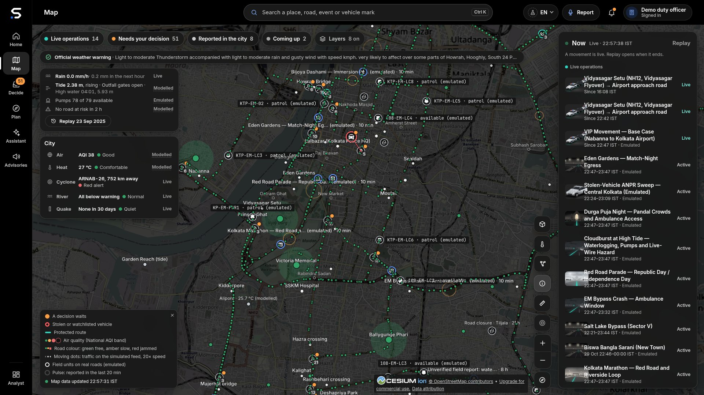
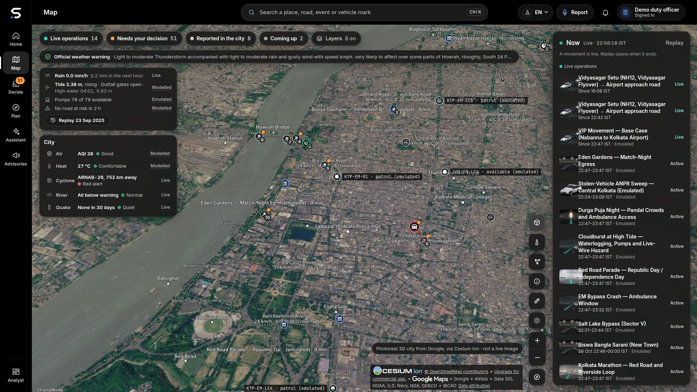
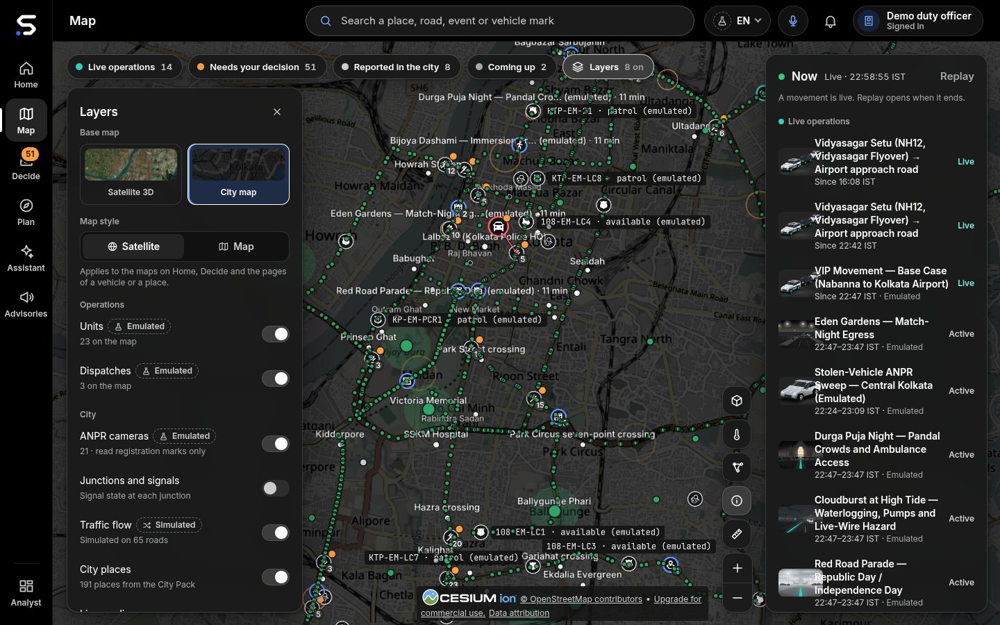
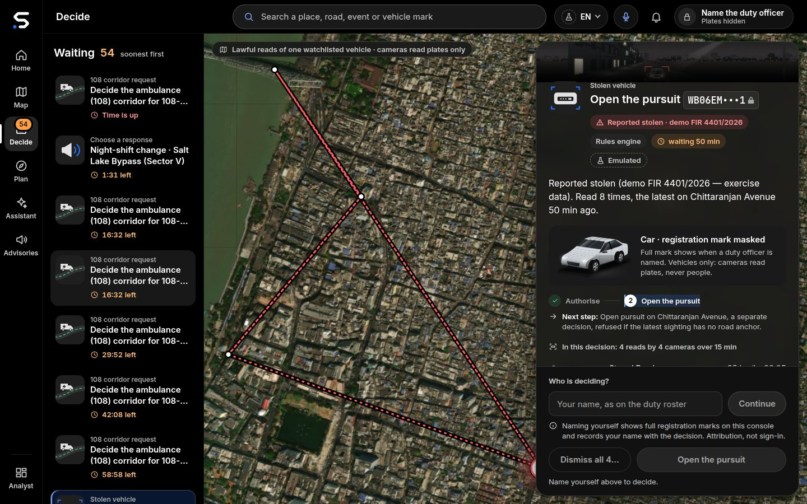
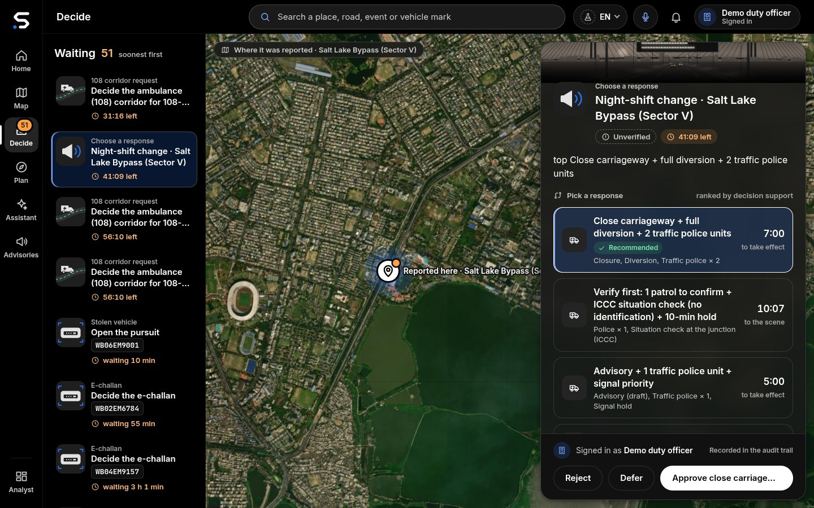
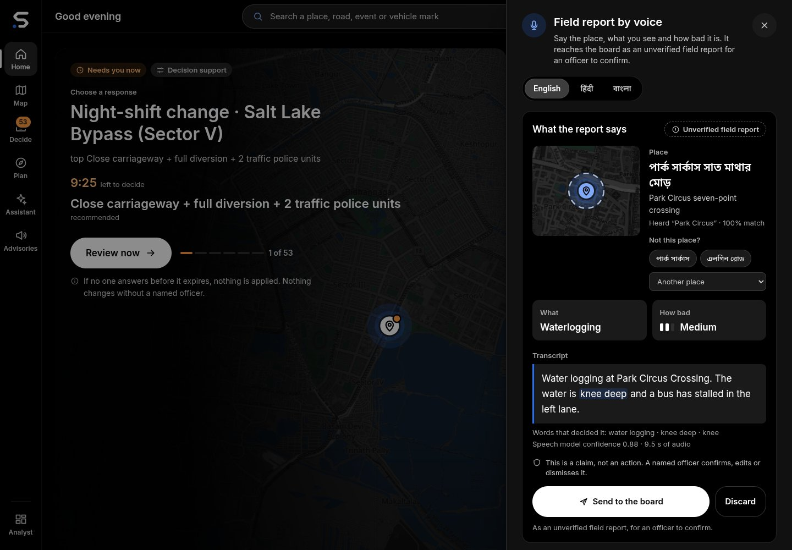
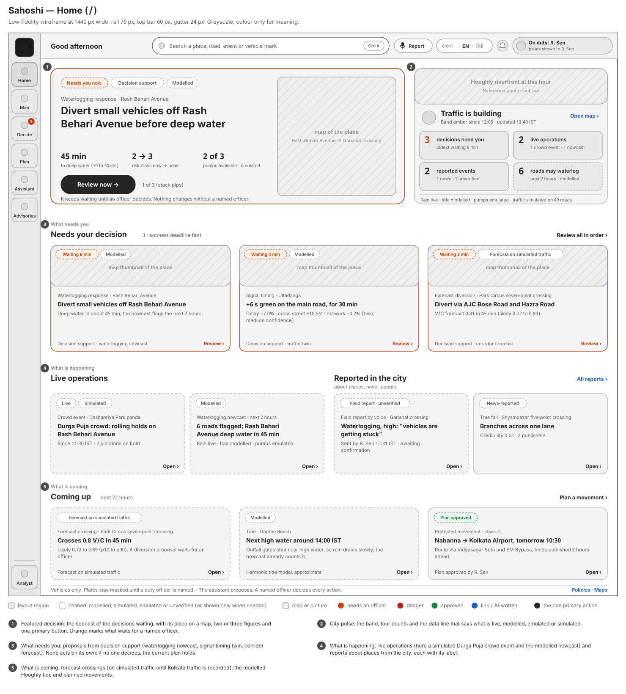
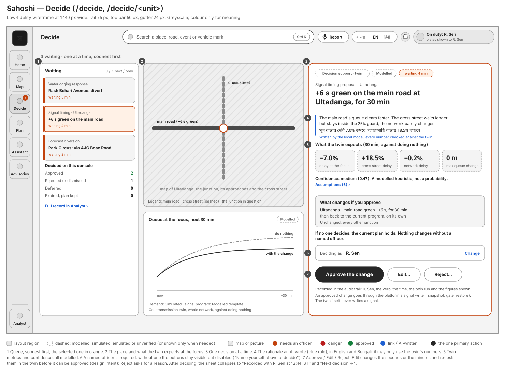
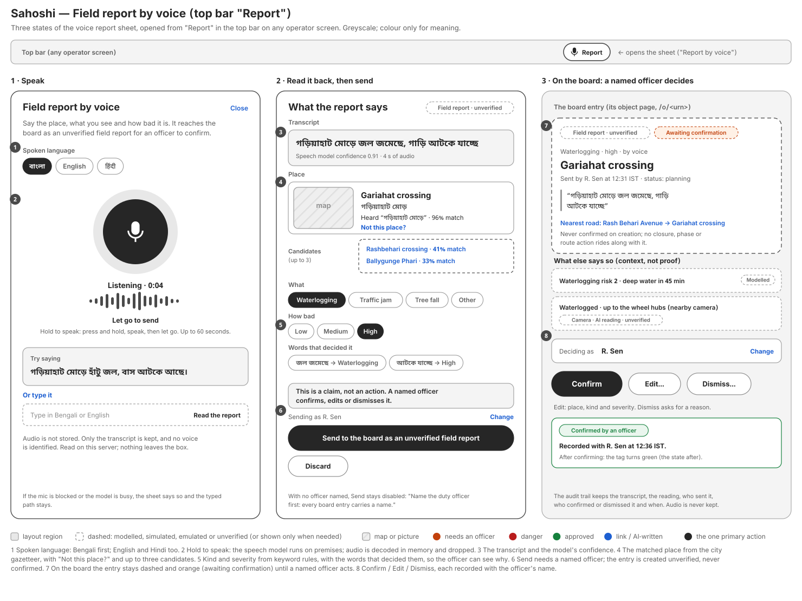

# Sahoshi — design notes

How Sahoshi looks and why: the visual language, colour, Bengali typography, imagery, honest labelling in the
interface, the screen patterns, accessibility, and wireframes of the key screens. The tokens named here live in
[`services/command-deck/src/lib/v3/tokens.css`](../services/command-deck/src/lib/v3/tokens.css) and
[`services/command-deck/src/lib/design/`](../services/command-deck/src/lib/design/); lint tests keep the code to
these rules.

---

## Contents

1. [Design intent](#1-design-intent)
2. [Visual language](#2-visual-language)
3. [Colour: only for meaning](#3-colour-only-for-meaning)
4. [The Sahoshi mark](#4-the-sahoshi-mark)
5. [Typography and Bengali](#5-typography-and-bengali)
6. [Imagery](#6-imagery)
7. [Honest labelling in the interface](#7-honest-labelling-in-the-interface)
8. [Screen patterns](#8-screen-patterns)
9. [The AI surfaces](#9-the-ai-surfaces)
10. [Copy rules in three languages](#10-copy-rules-in-three-languages)
11. [Accessibility](#11-accessibility)
12. [Wireframes](#12-wireframes)
13. [Known gaps](#13-known-gaps)

---

## 1. Design intent

**Simple by default, deep on demand.** A duty officer at 02:00 during a cloudburst has seconds, not minutes. Each
screen has one job and one primary action:

| Screen | Its one job | Its primary action |
|---|---|---|
| Home | What needs me, what is happening, what is coming | Review now |
| Map | Where things are, by layer | Select |
| Decide | One decision at a time | Approve (with my name) |
| Plan | Plan a movement | Find routes → Start escort |
| Report | Tell the system what I see | Hold to speak |
| Citizen | Is my road all right? | Search / Listen |

Every power tool (tables, filters, saved views, the situation wall, the 3D city) is kept one level deeper under
**Analyst**. Nothing was removed; some things moved down.

Three rules come before taste:

1. **A human decides.** Approve controls appear only where a named officer decides (Decide and the analyst
   workspace). The map, the assistant, object pages and public pages have none.
2. **Honest labels.** Anything not from a live feed says what it is, in words, next to the figure (§7).
3. **Vehicles and places, never people.** No interface element shows, asks about or describes a person.

## 2. Visual language

- **Neutral black, white and grey.** The operator console is dark (ground `#000000`, surfaces `#111111` to
  `#2E2E2E`, text `#FFFFFF` / `#CBCBCB` / `#A6A6A6`); the public pages are light (ground `#F6F6F6`). The primary
  button is white on the dark theme and black on the light one, not a brand colour.
- **Large, calm type** with one display size per screen; numbers set in tabular figures.
- **Rounded, quiet surfaces** (radii 8 / 12 / 16 / 22 px), soft elevation, a 36 / 44 / 56 px control scale.
- **Short motion** (120 / 200 / 320 ms, one easing curve), switched off under "reduce motion".
- **Maps are graded to the theme:** a dark, desaturated base so that colour on the map is always meaning.
- **Pictures, not only maps:** reference photographs, key art for every event kind, vehicle artwork and time-of-day
  scenes of Kolkata (§6).

| The live map, 2D city map | The live map, closer |
|---|---|
|  |  |
| *The City Pack drawn live: roads in their load colours (simulated), places, events, emulated units and the legend.* | *Closer in: each road's speed and V/C (simulated), events where they happen, units with their state (emulated).* |

## 3. Colour: only for meaning

Colour is never decoration in the console. Each role has one meaning and appears with a word or an icon, never
alone.

| Role | Dark theme | Light theme | Meaning |
|---|---|---|---|
| `--v3-decide` | `#FF9F43` orange | `#E07A1F` | A named officer must decide; the Decide badge; a countdown |
| `--v3-alert` | `#FF5C61` red | `#C62828` | Danger: impassable water (class 3), a stolen or watchlisted vehicle, a failure |
| `--v3-ok` | `#3CCB7F` green | `#1E9E5A` | Approved, healthy, dry |
| `--v3-ai` | `#5B91F5` blue | `#276EF1` | Text the AI wrote; an AI proposal's accent; links |
| `--v3-route` | `#2DD4BF` teal | `#0F9F8E` | A protected route and its progress |
| `--v3-dashed` | grey, dashed outline | grey, dashed | Emulated, simulated or unverified |

Waterlogging classes use a grey-to-red ramp with the class number and its name (0 dry, 1 shallow, 2 deep,
3 impassable) printed beside the swatch; forecast bands are drawn as a grey band with the median line, turning
orange only where the median crosses 0.8.

| Map: a road's forecast | Map: waterlogging, 23 Sep 2025 |
|---|---|
|  |  |
| *A road's card: waterlogging now (modelled) and its two-hour V/C band against 0.8 (simulated traffic).* | *The 2025 storm replayed: roads by risk class, a road's depth band and when it went deep (Hindsight, MODELLED).* |

## 4. The Sahoshi mark

The **Sahoshi mark** is an "S" drawn as one road: a single stroke of constant width with round ends, bending twice
(the chamfered bends keep Howrah Bridge's angular steel). Past the road's far end sits one dot in the accent blue
`#276EF1`: the place the movement is steered to. It says the tagline without words: *not by stopping, by
steering*.

The identity is **neutral**: white on black, black on paper, `currentColor` in the mono version. The blue dot is the
only colour, the same blue the console uses for links and the AI, so the mark never borrows a meaning colour (no
orange, red, green or teal) and there is **no yellow anywhere** in the product, its mark, favicon or landing page.
The wordmark is "Sahoshi" in Inter, outlined; the Bengali name is not part of the lockup (the product speaks English
first; Bengali and Hindi are one press away).

*Landing. The mark in its night lockup over the landing page's hero: neutral white on black, the one blue dot, no yellow; English first, with বাংলা and हिंदी one tap away.*

Brand files in [`services/command-deck/static/brand/`](../services/command-deck/static/brand/), all generated by
[`scripts/brand/build_brand.py`](../scripts/brand/build_brand.py) (never edited by hand): the mark (night, day, mono,
solid for 32 px and below), the wordmark and the lockups (horizontal and stacked, for dark and light grounds), the app
icon and the favicon. [`scripts/brand/render_icons.mjs`](../scripts/brand/render_icons.mjs) renders the PNGs: the
PWA and touch icons, `favicon.png`, `sahoshi-mark-512.png`, and `sahoshi-lockup.png` / `sahoshi-lockup-day.png` (2×,
transparent) for documents and decks. Unit tests hold the rules: `tests/v3-assets.unit.mjs` (neutral, exactly one
accent dot per mark, no warm colour) and `tests/v3-tokens.unit.mjs` (no yellow in any token or brand file).

## 5. Typography and Bengali

- **Faces:** Inter for Latin; **Noto Sans Bengali** for বাংলা; Noto Sans Devanagari for हिंदी; JetBrains Mono for
  identifiers and coordinates only. All self-hosted (SIL OFL 1.1), no font CDN on public pages.
- **Stack order:** Inter, Noto Sans, Noto Sans Bengali, Noto Sans Devanagari. Bengali comes before Devanagari because
  the two faces share the danda (।, U+0964), the double danda (॥) and the zero-width joiners. With Bengali first, a
  Bengali sentence takes its danda from its own face and a joiner never splits a Bengali shaping run across two
  fonts.
- **The danda.** Bengali sentences end with । , not a full stop. The Bengali packs were converted with a script that
  changes a sentence-final full stop to a danda only after a Bengali letter, leaving Latin, digits, ellipses and
  placeholders alone.
- **Digits.** The console uses Western digits (0–9) in every language, so figures read the same across officers;
  public pages may show Bengali digits (০–৯) through the formatter, as in অ্যাম্বুলেন্স (১০৮).
- **Script check.** `tests/bn-script.unit.mjs` checks every Bengali pack: the same keys as English, every visible
  piece in Bengali script once acronyms and codes are removed, and no Devanagari or other script mixed in.

## 6. Imagery

| Kind | What | Rule |
|---|---|---|
| Reference photographs | Howrah Bridge (day and night), Vidyasagar Setu, Victoria Memorial, Park Street, Chowringhee, Prinsep Ghat, the Hooghly, Eden Gardens, Salt Lake stadium, Biswa Bangla Gate, Howrah and Sealdah stations, the Metro, a Durga Puja pandal, Kumartuli idols, a waterlogged street | Wikimedia Commons, credited; always captioned **"Reference photo · not live"**; no face or legible plate as the subject (a painted taxi number and a ferry registration were removed) |
| Generated scenes | Kolkata at dawn, day, dusk and night; "all clear" | Illustration, never shown as a photograph |
| Vehicle artwork | Yellow Ambassador taxi, WBTC bus, toto (e-rickshaw), auto, ambulance, fire tender, convoy classes | Silhouettes and illustrations, no plates |
| Event key art | Flooding, cyclone, procession, mass gathering, egress surge, ghat transit, station surge, race, work zone and more | One picture per event kind |
| Agency and source marks | Kolkata Police, WB Police, Bidhannagar and Howrah City Police, KMC, NKDA, WBSDMA, NDMA (and Sachet), IMD, Metro, WBTC, Open-Meteo, Copernicus, OpenStreetMap | Credit line: "marks belong to their owners; not affiliated" |
| 3D city | Google Photorealistic 3D Tiles through Cesium ion | Labelled "not a live image"; signed-in officers only |

Credits: [`static/photos/NOTICE.md`](../services/command-deck/static/photos/NOTICE.md),
[`static/logos/NOTICE.md`](../services/command-deck/static/logos/NOTICE.md). A screenshot of another city's roads is
never used to stand for Kolkata.

## 7. Honest labelling in the interface

Every figure that is not from a live feed carries a short label beside it, in the reader's language, with a tooltip
that explains it.

| Label | Bengali | Means | Example |
|---|---|---|---|
| LIVE | লাইভ | From a live feed | The rain nowcast ("a model product, not a rain gauge") |
| EMULATED | এমুলেটেড | A stand-in for a feed Sahoshi cannot read yet | KMC pump status; the traffic feed; ANPR reads |
| SIMULATED | সিমুলেটেড | A scenario, not recorded | Durga Puja night; forecast history; twin demand |
| MODELLED | মডেল-ভিত্তিক | Computed, not measured | The tide; waterlogging risk; twin results; impact figures; camera positions |
| OBSERVED | — | Measured and published by IMD | Rain in the 2025 replay |
| HINDSIGHT | — | Observed rain replayed as if it had been a perfect nowcast | The replay snapshot ("Not today's city") |
| Field report · unverified | — | A voice report waiting for an officer | The voice sheet |
| Camera · AI reading · unverified | — | A vision reading waiting for an officer | Road state |
| Reference photo · not live | রেফারেন্স ছবি · লাইভ নয় | A credited photograph | Landing, object pages |
| Synthetic voice | — | Generated speech | Listen on the citizen page |
| Unavailable | — | The feed did not answer | "Nothing is shown as zero" |

Rules:

- A label is text, not only a colour or an outline. The dashed outline is a second signal.
- A missing feed shows "unavailable", never zero.
- A hindsight or exercise view says so in its title and keeps a way "Back to live".
- Plates show masked (`WB06EM•••1`, with a lock) until a named officer is on the console; the officer pill says
  what naming does.

| Map: layers | Decide: the mark masked until an officer is named |
|---|---|
|  |  |
| *Each layer with its label and count: units and cameras emulated, traffic simulated, 191 City Pack places.* | *No officer named: the mark is masked and every button waits for a name.* |

## 8. Screen patterns

- **The shell.** Left rail (Home · Map · Decide · Plan · Assistant · Advisories, Analyst below); a slim top bar with
  one search box, **Report**, the language menu (বাংলা · English · हिंदी), the alerts bell and the officer pill. Decide
  carries the only badge.
- **The decision card** (Decide): what is being decided → why → the key facts with labels → what changes if you
  approve or reject → one primary button with the officer's name. Buttons are visible but disabled, with the reason,
  until an officer is named. After a decision the card collapses to its outcome. A refusal is shown in the server's
  words, inside the card.
- **Object pages** (`/o/<urn>`): a hero map, the title and its tags, key facts, a timeline, then depth in tabs.
- **Sheets** for focused tasks (voice report, layers, replay) slide over the current screen and keep the map visible.
- **Empty states** say what would appear and why it is empty ("No road at risk in the next 2 hours").
- **Public pages** are one column on a phone, no sign-in, large touch targets and a visible language switch.

| Decide: choose a response | A road's page |
|---|---|
|  |  |
| *Ranked responses, the recommended one first (MODELLED); approval only creates dispatch requests.* | *Rash Behari Avenue: the two-hour V/C forecast with its p10–p90 band against the 0.8 line (simulated traffic).* |

| Citizen | Ambulance (108) crew |
|---|---|
|  |  |
| *Check your road: the status in plain words (modelled), Listen, the tide; no sign-in, no location.* | *One request for a corridor window, its four steps; a duty officer decides.* |

## 9. The AI surfaces

| Surface | Where | Design choices |
|---|---|---|
| **Rain · Tide chip** | Home and Map | Rain now (LIVE), tide and gate state ("Outfall gates open / shut", MODELLED), roads at risk in 2 h; each part has its own label and goes "unavailable" on its own |
| **Next 2 hours** | Home | Two short lists: roads likely or possibly over 0.8 V/C, roads at waterlogging risk, each with the band or class and the label |
| **Waterlogging layer** | Map | Class 0–3 on the road itself, lead time on selection, the four drivers listed with their labels |
| **Forecast layer and band** | Map, object page | Median line with the p10–p90 band and the 0.8 line; "Likely over 0.8" / "May reach 0.8" |
| **Replay 23 Sep 2025** | Map, Home | A time slider over the storm night; the title "Hindsight: 23 Sep 2025"; "IMD observed rain, modelled ponding. Not today's city."; "Back to live" |
| **AI proposals** | Decide | "Forecast, waterlogging and signal timing. You decide each one." The twin card shows do-nothing against the change (delay at the junction, longest queue, cross street, network), confidence, assumptions and the rationale in English and Bengali |
| **Field report by voice** | Top bar → Report | Hold to speak; the transcript; the place with "Not this place?"; kind, severity and "Words that decided it"; "Audio is not stored" |
| **Road state** | Map, object page | "Road state · AI reading"; "Sample still · not live" or "Your still, not stored"; depth judged against wheels and kerbs |
| **Listen** | Citizen | A play button beside the advisory; "synthetic voice" |

The AI's text is set in the AI colour (blue) or carries an "AI" tag, so an officer can always tell what the system
wrote from what a person wrote.

| Assistant | Field report by voice |
|---|---|
|  |  |
| *A grounded, read-only answer that says its traffic is synthetic; it cannot approve, unmask or dispatch.* | *Speech becomes place, kind and severity with the words that decided it; unverified until an officer confirms.* |

## 10. Copy rules in three languages

- Short, plain sentences. One idea per sentence. Verbs for buttons ("Review now", "Approve", "Hold to speak").
- Every string exists in English, Bengali and Hindi; every page, public pages included, opens in English, with Bengali and Hindi one tap away.
- Bengali in standard colloquial register (চলিত ভাষা), as in Kolkata Police and KMC public notices; "আপনি" for
  citizens; consistent terms from the glossary: প্রস্তাব (proposal), সিদ্ধান্ত (decision), জল জমা (waterlogging),
  জোয়ার (high tide), বিকল্প পথ (diversion), মোড় for a named crossing (গড়িয়াহাট মোড়), দুর্গাপুজো.
- "Ambulance (108)" in the console, অ্যাম্বুলেন্স (১০৮) on Bengali public pages; no claim of a partnership.
- Neutral, respectful language about every public body; no party names or symbols.
- The English copy lint (`tests/copy-lint.mjs`) checks every English string (4,263 on 28 Oct 2026) for all-caps
  shouting; acronyms are allow-listed.

## 11. Accessibility

- Contrast: the design-token test checks every text and meaning colour against its ground.
- Colour is never the only signal: every state has a word, and labels are text.
- Controls have visible focus states (`:focus-visible`) and labels; icons have accessible names.
- Keyboard: the omnibar opens with `Ctrl K` or `/`.
- `<html lang>` follows the reader's language so screen readers pick the right voice.
- Motion respects "reduce motion".
- The landing page collapses to one column below 640 px with no sideways scroll at 390 px (tested); the citizen and
  driver pages are single-column phone layouts.
- The voice report has a typed alternative; the Listen button is optional, the text is always shown.

## 12. Wireframes

Low-fidelity wireframes of the key screens are in [`wireframes/`](wireframes/) (SVG). They show layout, order of
information and the rules each screen keeps; the figures in them are samples.

| Wireframe | Screen |
|---|---|
| [`wf-shell.svg`](wireframes/wf-shell.svg) | The operator shell and the honest-label legend |
| [`wf-home.svg`](wireframes/wf-home.svg) | Home: what needs you, what is happening, what is coming |
| [`wf-map.svg`](wireframes/wf-map.svg) | Map with layer toggles and a selected road's drivers |
| [`wf-decide.svg`](wireframes/wf-decide.svg) | Decide: a twin-tested signal-timing proposal |
| [`wf-object.svg`](wireframes/wf-object.svg) | Object page for a road (Rash Behari Avenue) |
| [`wf-voice.svg`](wireframes/wf-voice.svg) | Field report by voice in Bengali |
| [`wf-citizen.svg`](wireframes/wf-citizen.svg) | Citizen: check your road, in the reader's language (English by default), with Listen |
| [`wf-driver.svg`](wireframes/wf-driver.svg) | Ambulance (108) crew: one-tap corridor request |
| [`wf-plan.svg`](wireframes/wf-plan.svg) | Plan a movement |

The live screens are in [`screenshots/`](screenshots/).

## 13. Known gaps

- Bengali copy has been written with a glossary and checked by script; a native read by an officer and a citizen
  panel is still recommended before a pilot.
- An "Edit" control on twin proposals (adjust the duration or the seconds before approving) is design intent, drawn
  in the Decide wireframe, and not built yet.
- Bengali digits on public pages are optional and not on by default.
- The tablet layout follows the desktop one; a field-phone layout of the console beyond the voice sheet is future
  work.
