# Sahoshi — Technical Design Document

**Sahoshi (সাহসী, "brave")** is a city-scale traffic, rain and crowd operations platform for Kolkata. This document
describes how it is built: the system context, the containers and ports, each service, the data model, the key
flows, the AI services, security and privacy, observability, deployment, testing, and the design decisions behind
them (ADRs).

Facts in this document are taken from the code in this repository. Where a figure was measured, the date is given.
Where a figure is an estimate, it is labelled MODELLED.

| | |
|---|---|
| Product description | [`../PRODUCT.md`](../PRODUCT.md) |
| Environment variables | [`ENVIRONMENT.md`](ENVIRONMENT.md) |
| Sample data and tests | [`SAMPLE_DATA_AND_TESTS.md`](SAMPLE_DATA_AND_TESTS.md), [`samples/`](samples/) |
| Design notes and wireframes | [`DESIGN_NOTES.md`](DESIGN_NOTES.md), [`wireframes/`](wireframes/) |
| AI capability notes | [`ai/forecast.md`](ai/forecast.md), [`ai/hydro.md`](ai/hydro.md), [`ai/speech.md`](ai/speech.md), [`ai/vision.md`](ai/vision.md), [`ai/twin.md`](ai/twin.md) |

---

## Contents

1. [Purpose, scope and goals](#1-purpose-scope-and-goals)
2. [System context](#2-system-context)
3. [Containers, ports and deployment](#3-containers-ports-and-deployment)
4. [Service design](#4-service-design)
5. [The AI services](#5-the-ai-services)
6. [The City Pack](#6-the-city-pack)
7. [Data model](#7-data-model)
8. [APIs](#8-apis)
9. [Key flows](#9-key-flows)
10. [State machines](#10-state-machines)
11. [Security](#11-security)
12. [Privacy](#12-privacy)
13. [Reliability and degradation](#13-reliability-and-degradation)
14. [Observability](#14-observability)
15. [Deployment and capacity](#15-deployment-and-capacity)
16. [Testing strategy](#16-testing-strategy)
17. [Architecture decision records](#17-architecture-decision-records)
18. [Known limitations](#18-known-limitations)

---

## 1. Purpose, scope and goals

### 1.1 Purpose

Kolkata's traffic police, the city corporation (KMC), the state disaster authority (WBSDMA) and ambulance (108)
crews each see part of the city. Sahoshi gives them one live picture of roads, rain and crowds, and a loop in which
the AI **proposes** and a **named officer decides**. Citizens get the decided advisories in Bengali, English and
Hindi, with voice.

### 1.2 Scope

- One web console (the command deck) for officers, with public pages for citizens and ambulance crews.
- A platform of services: the system of record and numeric engine (traffic-oracle), the AI orchestrator
  (convoy-brain), the emulated city (event-emulator), the traffic ingress (signal-ingress), the store
  (corridor-store), event intelligence from open sources (OSINT) and a memory service (embedding-service).
- Five AI services added for Kolkata: corridor forecasting, waterlogging nowcast, Bengali voice, road-state vision
  and a signal-timing twin.
- A City Pack (`cities/<id>/`) from which every city-specific file is generated.

### 1.3 Goals

| Goal | How |
|---|---|
| A human decides every action | Every AI output is a proposal object with `requires_officer: true`; the server refuses an unnamed decision; no answer means the current plan holds |
| Honest about what is real | Every record carries its provenance: LIVE, EMULATED, SIMULATED, MODELLED, UNVERIFIED-FIELD, UNVERIFIED-CAMERA, NEWS-REPORTED, OFFICIAL-VERIFIED |
| Vehicles and places, never people | No person, face or biometric field exists on any path; vision refuses person and plate questions; OSINT is aggregate |
| Runs on premises | Every model runs on one edge server beside the control room; no cloud inference |
| Bengali first | Public pages default to বাংলা; voice in and out in Bengali; Bengali rationales checked by code |
| A new city is a new folder | The City Pack and `scripts/city_build.py` |

### 1.4 Non-goals

- Sahoshi does not control signals, barricades or dispatch on its own. Signal changes go through an adapter that is
  emulated today, and only after an officer approves.
- It does not identify or track people.
- It does not replace agency radio or computer-aided dispatch. Advisories are drafts that an officer sends.

### 1.5 Real, emulated, simulated and modelled

| What | Status today | Label |
|---|---|---|
| Road network, junctions, stations | Real roads from OpenStreetMap | — |
| Rain nowcast | Live (Open-Meteo, a model nowcast, not a gauge) | LIVE |
| Hooghly tide at Garden Reach | Harmonic model from cited constants | MODELLED (approximate) |
| Waterlogging risk | Conceptual ponding model | MODELLED |
| KMC pumping stations (FFEWS) | Adapter stand-in until access is granted | EMULATED |
| Traffic feed | Synthetic field through the real ingress pipeline | SIMULATED / EMULATED |
| Corridor forecasts | Chronos-2 on simulated history | "Forecast on simulated traffic" |
| Signal programs, camera sites | Standard templates at OSM signal positions; camera positions at signalised junctions | MODELLED |
| Signal-timing proposals | Cell-transmission twin | MODELLED |
| Field voice reports | Real ASR on the officer's speech | UNVERIFIED-FIELD until confirmed |
| Camera road state | Real VLM on a still | UNVERIFIED-CAMERA until confirmed |
| News and alerts | Real open sources, aggregate only | UNVERIFIED-OSINT / NEWS-REPORTED / OFFICIAL-VERIFIED |
| Scenarios (Puja night, cloudburst, cyclone …) | Emulator scenarios | SIMULATED |
| Impact figures | Deterministic model with an assumptions ledger | MODELLED |

---

## 2. System context

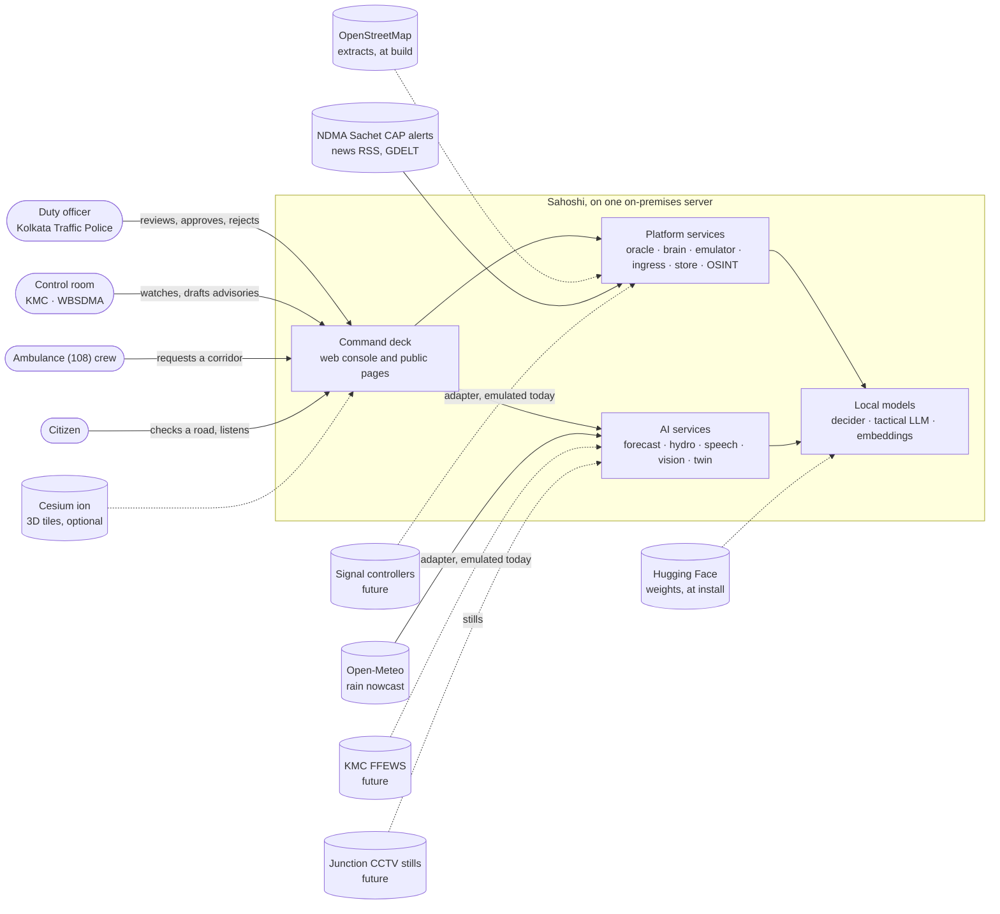

### 2.1 Actors

| Actor | Uses | Can do |
|---|---|---|
| Duty officer (Kolkata Traffic Police, Bidhannagar or Howrah City Police) | The console | Name themselves, review and decide proposals, plan movements, record voice reports, confirm field and camera readings |
| Control room (KMC, WBSDMA) | The console | Watch rain, tide, pumps and waterlogging risk; draft advisories |
| Ambulance (108) crew | `/driver` | Request a corridor; see its status |
| Citizen | `/citizen`, `/welcome` | Check a road in Bengali, English or Hindi; listen to an advisory |

### 2.2 External systems

| System | Direction | Use | Status |
|---|---|---|---|
| OpenStreetMap (Overpass) | In, at build time | Road network, drains, stations | Committed extracts, ODbL |
| Copernicus DEM GLO-30 | In, at build time | Terrain for waterlogging susceptibility | Committed result |
| Open-Meteo | In, live | 15-minute rain at 18 points | No key; cached 10 min; at most one call per 30 s; daily cap |
| NDMA Sachet (CAP), news RSS, GDELT, Reddit RSS | In, live | OSINT signals | Off by default (`SAHOSHI_OSINT=0`); allow-listed hosts |
| Cesium ion | In, optional | Photoreal 3D tiles for signed-in officers | Needs a token; otherwise keyless OpenStreetMap |
| Hugging Face Hub | In, at install | Model weights | Never at run time (`HF_HUB_OFFLINE=1`) |
| KMC FFEWS | In, future | Pump and sump state, gauges | Emulated adapter |
| Junction CCTV | In, future | Stills for road-state vision | Upload path ready; no feed connected |
| Signal controllers | Out, future | Approved timing changes | Emulated adapter; the twin never writes |

---

## 3. Containers, ports and deployment

### 3.1 Containers and ports

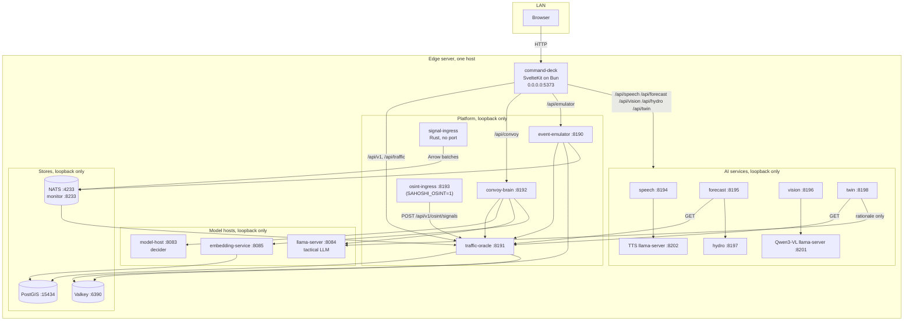

| Component | Port | Bind | Started by |
|---|---|---|---|
| command-deck | 5373 | 0.0.0.0 (the only LAN surface) | compose (`sahoshi_up.sh`) |
| event-emulator | 8190 | 127.0.0.1 | compose |
| traffic-oracle | 8191 | 127.0.0.1 | compose |
| convoy-brain | 8192 | 127.0.0.1 | compose |
| osint-ingress | 8193 | 127.0.0.1 | compose, with `SAHOSHI_OSINT=1` |
| speech | 8194 | 127.0.0.1 | `infra/compose.ai-media.yml` |
| forecast | 8195 | 127.0.0.1 | `infra/compose.ai.yml` |
| vision | 8196 | 127.0.0.1 | `infra/compose.ai-media.yml` |
| hydro | 8197 | 127.0.0.1 | `infra/compose.ai.yml` |
| twin | 8198 | 127.0.0.1 | `infra/compose.twin.yml` |
| Qwen3-VL llama-server | 8201 | 127.0.0.1 | `services/vision/scripts/serve_llm.sh start` (the container deployment); on bare metal vision starts it on demand (`VISION_LLM_MANAGE=1`) |
| TTS llama-server | 8202 | 127.0.0.1 | started on demand by speech on bare metal (`SPEECH_TTS_BACKEND=auto`); the container runs TTS in transformers instead |
| model-host (decider) | 8083 | 127.0.0.1 | systemd user unit `sahoshi-decider.service` |
| llama-server (tactical LLM) | 8084 | 127.0.0.1 | `sahoshi-llama.service` |
| embedding-service | 8085 | 127.0.0.1 | `sahoshi-embed.service` |
| PostGIS | 15434 | 127.0.0.1 | compose |
| Valkey | 6390 | 127.0.0.1 | compose |
| NATS | 4233, monitoring 8233 | 127.0.0.1 | compose |

### 3.2 Compose files

| File | What it adds |
|---|---|
| `infra/compose.yml` | The base services |
| `infra/compose.gb10-override.yml` | The arm64 edge server: host networking for the services that must reach loopback model hosts |
| `infra/compose.argus-override.yml` | The deployed project `sahoshi`: container names, the port map, loopback binds, pass-through flags, healthchecks |
| `infra/compose.osint-ingress.yml` | The OSINT service (only with `SAHOSHI_OSINT=1`) |
| `infra/compose.ai.yml` | forecast and hydro |
| `infra/compose.ai-media.yml` | speech and vision |
| `infra/compose.twin.yml` | the twin |

The base invocation is `docker compose -p sahoshi -f infra/compose.yml -f infra/compose.gb10-override.yml -f
infra/compose.argus-override.yml`; `scripts/sahoshi_env.sh` exposes it as the shell function `sahoshi_compose`.
The AI stanzas are layered over it by hand (each file's header gives the command).

### 3.3 Systemd units and boot

`infra/systemd/` holds `sahoshi.target`, `sahoshi-models.target`, `sahoshi-decider.service`,
`sahoshi-llama.service`, `sahoshi-embed.service` and `sahoshi-up.service`. `scripts/sahoshi_up.sh
--install-units` links them into `~/.config/systemd/user` and enables `sahoshi.target`; at boot the model hosts
start and `sahoshi-up.service` runs `sahoshi_up.sh --boot`. Every unit reads `~/.config/sahoshi/sahoshi.env`.

### 3.4 Bring-up order (`scripts/sahoshi_up.sh`)

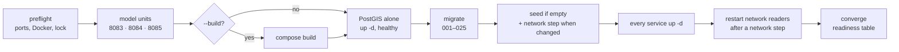

The readiness table has 11 components (12 with OSINT): postgis, valkey, nats, signal-ingress, oracle, brain, deck,
emulator, (osint), decider, gemma, embeddings, plus a security row (the deck's bind scope and gate state; a deck on
the LAN with the gate off is DEGRADED). `--status` is read-only and exits 0 only when every component is READY.
The five AI services are brought up with their own compose files and report on their own `/health`.

---

## 4. Service design

### 4.1 command-deck

**Stack:** SvelteKit (Svelte 5), TypeScript, adapter-node on Bun, MapLibre and CesiumJS. **Source:**
`services/command-deck/`.

#### Route groups

| Group | Routes | Theme and policy |
|---|---|---|
| `(v3)` operator pages | `/` (Home), `/map`, `/decide`, `/decide/[unit]`, `/plan`, `/assistant`, `/o/[urn]` (object pages) | Night theme; operator CSP |
| `(deck)` analyst pages | `/analyst` (workspace), `/ops` (situation wall), `/gods-eye` (3D city), `/chat`, `/comms` (advisories) | Night theme; operator CSP |
| `(public)` | `/citizen`, `/driver` | Day theme; strict public CSP; Bengali first for `/driver` |
| `(landing)` | `/welcome` | Public; no API calls |
| `api/session` | `POST /api/session` (sign in), `GET` (gate state) | — |

`src/hooks.ts` reroutes `/` to Home and `/analyst` to the workspace; every per-page decision (CSP, theme, default
language) reads the resolved route id, not the URL.

#### Request pipeline (`src/hooks.server.ts`)

1. **WebSocket upgrades** are answered 501 at once (adapter-node cannot upgrade; clients fall back to polling).
2. **Machine ingest refusal:** any write to `/api/v1/osint/signals`, under every decoding of the path, is 403 before
   the gate and before any fetch. Only osint-ingress posts there, directly on loopback.
3. **Operator gate** (when `SAHOSHI_OPERATOR_PIN` is set): every proxied request without the signed session cookie
   is default-denied (403), except public road geometry, liveness probes, the ambulance request (rate-capped) and
   the public AI allow-list (§11.2).
4. **Proxy:** fixed loopback targets; only ports are configurable.

   | Prefix | Target |
   |---|---|
   | `/api/v1`, `/api/traffic` | traffic-oracle |
   | `/api/convoy` | convoy-brain (prefix stripped) |
   | `/api/emulator` | event-emulator (stripped) |
   | `/api/speech`, `/api/forecast`, `/api/vision`, `/api/hydro`, `/api/twin` | the AI services (stripped) |

   After building the upstream URL the hook asserts its origin is still the rule's loopback target (a
   protocol-relative path cannot turn the proxy into an open relay).
5. **Headers** on every response: `nosniff`, a referrer policy, `X-Frame-Options: DENY`, a permissions policy (no
   geolocation) and a nonce-based CSP per document (§11.4).

#### Public projection

The citizen and driver pages read a server-side projection (`/api/public/*`), never the raw APIs. It carries only
public facts, labels every emulated row (`emulated_labelling: true`) and never carries a plate.

#### Languages

`bn`, `en` and `hi` packs per feature (`src/lib/i18n/packs.*.ts`). The reader's choice is a cookie
(`sahoshi_lang`); `<html lang>` follows it. Noto Sans Bengali and Noto Sans Devanagari are self-hosted (OFL).

### 4.2 traffic-oracle

**Stack:** Python 3.12, FastAPI, asyncpg, valkey, nats-py, OR-Tools, NetworkX, ONNX Runtime. **Source:**
`services/traffic-oracle/src/traffic_oracle/`.

The system of record and the numeric engine. Every write of city state (events, routes, sightings,
recommendations, dispatches, signal plans, OSINT situations, decision-support records) goes through it.

| Module | Responsibility |
|---|---|
| `data/` | Settings, database pool, Valkey cache, pgRouting queries |
| `ingest/` | NATS consumers (`corridor.traffic.live`, `.emulated`, `.anomaly`, `corridor.units.emulated`); Arrow decode; buffered writes to `traffic.observations`; newest row per segment to Valkey |
| `predict/` | The platform's traffic forecast ladder, with labelled fallbacks |
| `optimize/` | Routing (OR-Tools, pgRouting k-shortest), diversion planner |
| `adaptive/` | **Active Movement Adaptation** (below) |
| `simulation/` | A seeded Monte-Carlo twin of corridor events; the scenario library export |
| `events/` | Corridor events: create, the live board, lifecycle, routes |
| `vehicles/`, `enforcement/` | The watchlist with lawful basis and capped retention; the ANPR ingest seam; e-challan rules that only create PENDING recommendations; the stolen-vehicle rule |
| `units/` | Five-agency dispatch channel and lifecycle |
| `signals/` | City signal plans: default-off writer, twin shadow evaluation before any write, snapshot and restore |
| `city/` | City fusion, entities, the feed, cameras, plate masking of every label and text |
| `osint/` | Machine ingest of redacted signals, the trust boundary, re-fusion, officer promotion |
| `decision_support/` | Courses of action, AHP + lexical veto + TOPSIS, wargames, the human-gated decision |
| `ops/` | The degradation ledger |
| `coordination.py` | Guarded router registration: a module that cannot import is replaced by a stub answering 503 "not deployed", so the oracle always boots |

**Active Movement Adaptation** (`adaptive/` with `signals/`), six stages:

1. **Situation** — each active subject (a corridor event or movement) is classified GREEN / AMBER / RED / BLACK
   from congestion, weather, crowd, anomaly and GPS-age scores. Emulated traffic can drive only an emulated event.
2. **Hysteresis** — a class change must persist through its dwell window before adoption.
3. **Protocol floors** — advance-closure floors by protection class (Z+ 180 s, Z 120 s, Y 60 s) on every publish.
4. **Twin shadow evaluation** — any deviation from baseline must beat it in a paired twin run, or the engine
   fails closed to baseline.
5. **Audited persistence** — every observation to `adaptive.situation_log`, every publish to
   `adaptive.param_overrides`, mirrored to Valkey (30 s TTL).
6. **City signal plans** — the city band (the most severe subject) maps to a bounded green-split shift (AMBER 6 %,
   RED 12 %, BLACK 18 % of the cycle, with a cross-street floor); cycle and offsets never change. The writer is off
   by default (`VVIP_SIGNAL_POLICY_WRITER`), every apply is operator-triggered and attributed, and the prior
   program is snapshotted for restore.

### 4.3 convoy-brain

**Stack:** Python 3.12, FastAPI, httpx, valkey. **Source:** `services/convoy-brain/src/convoy_brain/`.

The brain orchestrates the platform's decision AI. It asks the models, runs deterministic tools through the
oracle, checks every claim, and turns anything that would change a plan into a proposal for a named officer.

- **Two tiers.** The strategic tier is a 27B decider model served by model-host as **typed questions** (choice,
  probability, score), never as a chat model. The tactical tier is a Gemma 4 12B model on llama-server, which drafts
  tool arguments against each tool's JSON schema and words answers. Below both sits a deterministic heuristic floor.
  Every fallback is recorded.
- **Workflows.** Pre-movement planning, live escort (a background task per movement; one open proposal at a time;
  approval timeout 90 s by default, configurable 15–600 s; on timeout the current plan holds) and post-clearance.
- **Grounding validator** (`grounding.py`): checks argument provenance before a tool runs, resolves typed road names
  against the network, and checks every sentence of an answer against the turn's tool results.
- **MCP** (`POST /mcp`, JSON-RPC 2.0): 29 tools, read-only by construction. A regular expression refuses any tool
  whose name contains approve, decide, earmark, dispatch_request, withdraw or transition.
- **Memory.** Each movement's context and its decisions log live in Valkey (`convoy:context:{movement_id}`); the
  embedding service finds similar past situations.

### 4.4 event-emulator

**Stack:** Python 3.12, FastAPI, psycopg, valkey, nats-py, pyarrow. **Source:** `services/event-emulator/`.

The emulated half of the city. It injects **causes only** (procession schedules, marathon waves, weather onset,
incidents, ambulance requests, departures, emulated ANPR reads, patrolling units) through the real services' real
APIs, and never produces outcomes (decisions, bands, recommendations). Every row it writes is labelled emulated.
Runs are deterministic (a tape is a function of spec, seed and start time), run-scoped, stoppable and replayable;
a tape whose route is not a legal path on the current network is refused. The **living city**
(`EMULATOR_LIVING_CITY`, off by default) runs a deterministic day program of overlapping emulated causes, and is
refused unless the public pages label emulated events.

### 4.5 signal-ingress

**Stack:** Rust, tokio, arrow, async-nats. **Source:** `services/signal-ingress/`.

Four feed adapters (government traffic, mapping API, fleet GPS, crowdsource) observe one synthetic congestion field
over the Kolkata segments compiled into the binary (`src/feeds/segments_kolkata.rs`, generated by
`scripts/gen_ingress_segments.py`). **No live connector is wired: every row is published as synthetic.** Pipeline:
feeds → bounded channel → eight plausibility checks (future timestamp, stale data, speed jump, phantom reading,
speed z-score, congestion outlier, road-class mismatch, spatial mismatch) → batcher (100 rows or 100 ms) → Arrow
IPC → NATS `corridor.traffic.live`; anomalies to `corridor.traffic.anomaly` with a `feed_quality` field.

### 4.6 corridor-store

PostgreSQL 16 with PostGIS, pgRouting, pgvector and pg_trgm. `scripts/migrate.py` applies `migrations/001–025` in
order and ledgers each (name, checksum, applied time). The seed is generated from the City Pack (§6) and applied in
a fixed order: `sample_corridor.sql` (empty store only) → `reanchor_osm_network.sql` (idempotent, ids preserved) →
`post_seed_derivations.sql` → `display_geometry_osm.sql`.

### 4.7 OSINT services

Off by default (`SAHOSHI_OSINT=0`). Four Python packages, one runtime container:

| Package | Runs in | Responsibility |
|---|---|---|
| `osint-common` | ingress and oracle | The types (`RawOsintSignal`, situations), the closed vocabulary of event classes, the ethics checks (no person keys, PII detection) |
| `osint-ingress` | its own container, `:8193` | Scheduler and connectors (NDMA Sachet CAP, Google News RSS, GDELT, Reddit RSS, official pages), the allow-listed HTTPS client, robots.txt, redaction at parse, the capture cache, publishing with an outbox |
| `osint-geo` | oracle | Offline gazetteer resolver with transliteration; snapping to the network |
| `osint-analysis` | oracle | Classify, fuse, correlate, score credibility, attach to live events, flag second-order effects |

Rules enforced in code: names and ages are redacted at parse; a single social post is never surfaced and is capped
at credibility 0.30; `OFFICIAL-VERIFIED` needs an official source; a surfaced situation must be located in the city;
`crime_incident` and `vehicle_pursuit` can never come from OSINT.

### 4.8 embedding-service

`127.0.0.1:8085`, run by `sahoshi-embed.service`. Late-interaction memory for "similar past situations":
`pplx-embed-v2-late-0.6b` multi-vector embeddings (128-d per token, MaxSim rerank) with `bge-m3` dense recall
(1,024-d). Routes: `POST /embed/documents`, `POST /search`, `POST /incidents`, `GET /incidents/recent`,
`GET /health`.

### 4.9 model-host and llama-server

- **model-host** (`127.0.0.1:8083`) serves the decider (`pplx-decider-v1-27b`, 48.6 GiB BF16). API:
  `POST /decide` with `{state, questions}`, at most 6 questions batched into one forward pass; question types
  `choice`, `noul` (a probability), `score`. Explicit errors: 429 when 8 requests are queued, 503 while loading, 413
  when the state exceeds 8,192 tokens (never truncated). No outbound calls.
- **llama-server** (llama.cpp) serves the tactical Gemma 4 12B Q4_K_M GGUF on `127.0.0.1:8084` with 2 parallel
  slots of 8,192 tokens, Prometheus metrics and the GGUF chat template. The twin also uses it to word rationales.

---

## 5. The AI services

All five are FastAPI services on loopback, reached by the deck through `/api/<service>`. They share one pattern:
**lazy model loading, unload when idle, refuse below a memory floor, label every output, and return proposals,
never actions.**

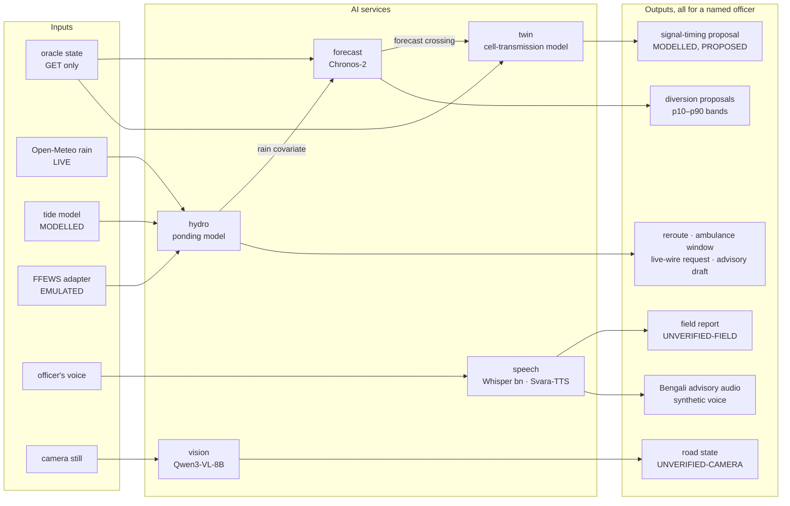

| Service | Port | Model (licence) | Runtime | Memory (measured) | Fallback |
|---|---|---|---|---|---|
| forecast | 8195 | Chronos-2 `amazon/chronos-2` (Apache-2.0); TimesFM 2.5 for backtests (Apache-2.0) | PyTorch, GPU | 456 MiB weights, 1.6 GiB peak | Seasonal-naive baseline, stated in `model_note` |
| hydro | 8197 | None (a conceptual model) | Python, CPU | < 512 MiB | Cached rain; offline mode |
| speech | 8194 | `bengaliAI/tugstugi_bengaliai-asr_whisper-medium` (Apache-2.0); `openai/whisper-large-v3-turbo` for en/hi (MIT); Svara-TTS v1 (Apache-2.0) + SNAC 24 kHz (MIT) | ASR in transformers fp16; TTS on llama.cpp (Q8_0 GGUF) on bare metal, transformers bf16 in the container | ≈2.0 GiB ASR; 4.8 GiB TTS | 503 when memory is short; typed reports need no model |
| vision | 8196 | Qwen3-VL-8B-Instruct Q4_K_M (Apache-2.0) | llama.cpp `llama-server` on 8201 | 7.6 GiB | 503 when memory is short |
| twin | 8198 | None for the timing; the tactical LLM only words the rationale | numpy, CPU | < 768 MiB | Template rationale |

### 5.1 Corridor forecasting (`services/forecast`)

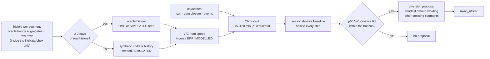

- Covariates: rain (from hydro, LIVE), outfall-gate closure from the tide model (MODELLED), active events.
- Backtest on simulated traffic (28 Oct 2026, 780 series): Chronos-2 with covariates MAE 0.0429 V/C, coverage 0.797,
  +54.9 % skill over the baseline. These numbers show the pipeline works; they do not measure accuracy on Kolkata
  roads.
- Every response carries `data_labels` and `data_note` ("Forecast on simulated traffic" until the oracle stores real
  Kolkata traffic).

### 5.2 Waterlogging nowcast (`services/hydro`)

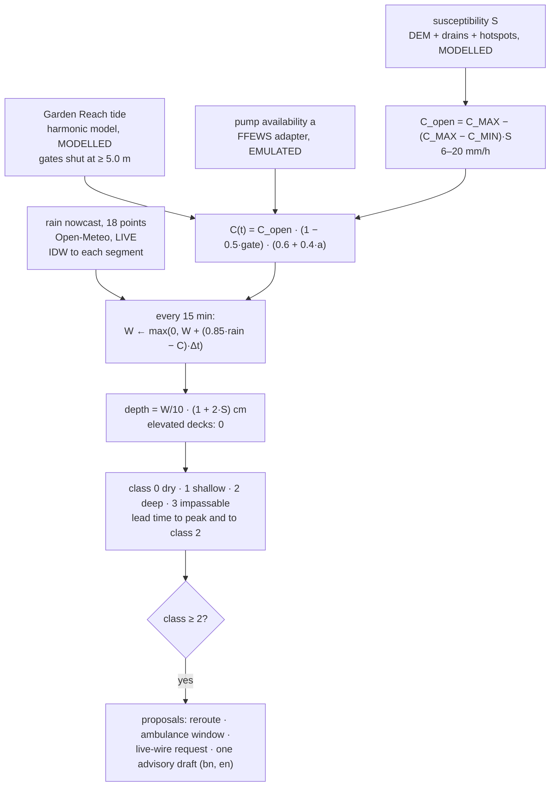

- The capacity bounds come from public statements by KMC and the Mayor; the other parameters are stated
  assumptions.
- Validation: the tide model is within ~20 minutes of published Garden Reach high waters on 28 Oct 2026, and its
  gate closure on 23 Sep 2025 (00:15–04:30 IST) covers the reported closure (00:30–04:00). The gauge-anchored replay
  of the 22–23 Sep 2025 storm flags 13 of 13 on-network places the news reported; the first flag is at 02:45 IST,
  before the 03:00–04:00 peak hour. The Open-Meteo archive carries only 20.5 mm for the same night against 248.8 mm
  measured at Alipore, which is why a gauge feed is the pilot's first need.

### 5.3 Bengali voice (`services/speech`)

- `POST /speech/report` takes the browser recording (`audio/webm` or `audio/wav`) or JSON `{"text": …}`. The
  transcript is matched to a place (fuzzy over `landmarks.json`, the gazetteer and spoken aliases, with a
  cross-script consonant skeleton) and to a kind and severity (keyword rules with negation; the deciding words are
  returned). The report is always `UNVERIFIED-FIELD` with `requires_confirmation: true`.
- `POST /speech/speak` returns 24 kHz WAV for Bengali, English or Hindi, with `X-Speech-Label: synthetic-voice`.
  Synthesis is seeded, so one text gives one waveform and the cache is exact.
- Audio is decoded in memory and dropped; there is no speaker identification and no voice storage.
- Evaluation (synthetic round trip, 60 clips): CER 2.6 %, place 53/60, kind 60/60, median 1.55 s per report.

### 5.4 Road-state vision (`services/vision`)

- `POST /vision/road-state` with a JPEG or PNG returns one of `waterlogged`, `blocked`, `tree_fall`,
  `stalled_vehicle`, `crash_debris`, `congested`, `clear`, `unknown`, a depth band judged against vehicles and
  kerbs (`none`, `below_kerb`, `up_to_wheel_hub`, `above_wheel_hub`), a vehicle estimate and a rationale of at most
  25 words. State `UNVERIFIED-CAMERA`, `requires_confirmation: true`.
- Three layers keep it to roads and vehicles: the system prompt; a query screen that answers person and plate
  questions with 403 before the model is called; and a sentence-level output filter.
- Decoding is constrained by a JSON schema with enums, so the state can never be outside the list. Image metadata
  is stripped.
- Evaluation (12 credited photos): 11/12 correct; 9/9 refusal probes; median 3.0 s warm.

### 5.5 Signal-timing twin (`services/twin`)

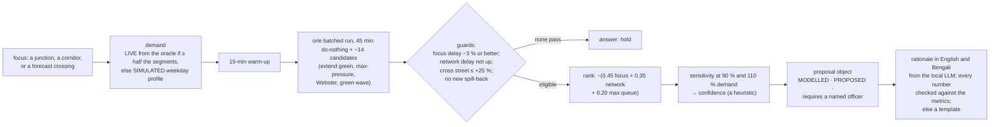

- A cell-transmission model (Daganzo) of the whole Kolkata network: 49 junctions, 123 directed links, 5,979 cells.
  30 minutes of simulation take 0.12 s on the CPU; 20 candidates in one batch take 0.85 s.
- Baselines: Webster's cycle and split, and cyclic max-pressure, both simulated against the current program
  (`GET /twin/baselines/{junction}`).
- The twin never writes a signal and has no client for the writer. An approved proposal goes to the oracle's signal
  writer (snapshot, gate, restore), which itself is off by default.

---

## 6. The City Pack

A city is a folder: `cities/<id>/` holds `city.json`, `landmarks.json`, `corridors.json` and `osm/`. Everything
else is derived.

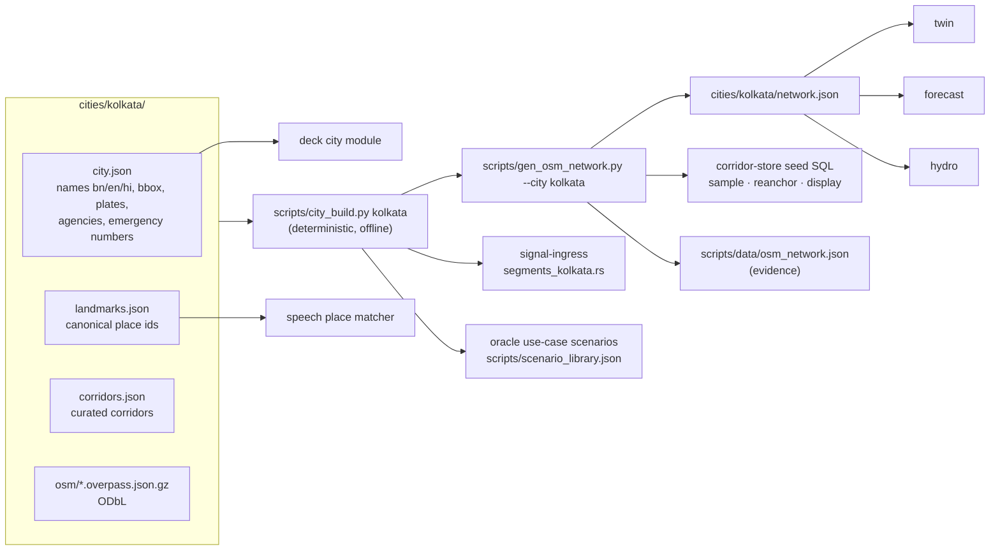

- `--check` rebuilds into a temporary folder and compares (4.5 s on 28 Oct 2026). Run twice, the second run changes
  nothing.
- A second, reference pack for another city is kept, and `services/corridor-store/tests/test_city_build.py` builds
  both.
- Per new city, what changes: the four pack files, a hotspot list and susceptibility build for hydro, place aliases
  for speech, the language list, and the agency marks. The services do not change.

---

## 7. Data model

### 7.1 Schemas

| Schema | Tables (selected) | Migrations |
|---|---|---|
| `corridor` | `road_segments`, `junctions`, `segment_adjacency`, `signal_programs`, `signal_program_history`, `signal_plan_log`, `cameras`, `agency_stations`, `vehicles`, `vehicle_earmarks`, `vehicle_sightings`, `vehicle_lookup_audit`, `dispatches`, `dispatch_events`, `protocol_params` | 001, 006, 007, 010–013, 020, 024–025 |
| `traffic` | `observations` (partitioned daily), `hourly_aggregates`, `hourly_aggregates_synthetic`, `synthetic_observations`, `anomaly_log`, `incidents`, `memory_docs`, `segment_embeddings`, `memory_segment_embeddings` | 001–004, 019 |
| `events` | `corridor_events`, `event_routes`, `event_phases`, `event_profiles`, `event_status_log`, `enforcement_recommendations` | 007, 008, 010, 013, 017, 018 |
| `convoy` | `movements`, `planned_routes`, `diversions` | 001 |
| `adaptive` | `situation_log`, `param_overrides` | 005 |
| `simulation`, `emulator` | `runs`, `calibrations`, `emulation_runs` | 006, 009, 016 |
| `osint` | `raw_signals`, `gazetteer`, `geocodes`, `resolved_events`, `event_sources` | 021, 023 |
| `decision` | `decision_support`, `coa`, `coa_sim_runs`, `dss_decision_log` | 022 |

### 7.2 Core entities

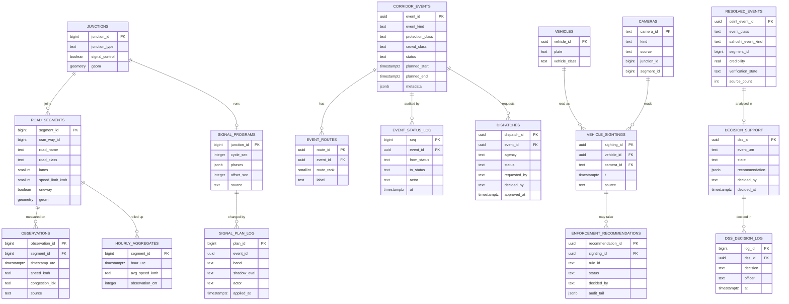

Rules held by the schema: a watchlist entry needs an enumerated lawful basis and a retention capped at 90 days
(CHECK); recommendation and status logs are append-only; every decision row carries the officer's name; vehicle
lookups by an officer are audited (`vehicle_lookup_audit`, which stores only the masked mark).

### 7.3 Valkey keys and NATS subjects

| Key or subject | Writer | Reader |
|---|---|---|
| `traffic:latest:{segment_id}` | oracle ingest (live feed) | oracle, adaptive engine |
| `traffic:emulated:latest:{segment_id}` | oracle ingest (emulated feed) | emulated events only |
| `adaptive:inputs:{id}`, `emulator:source:{id}` | event-emulator | adaptive engine |
| `convoy:context:{movement_id}` | convoy-brain | convoy-brain |
| `units:emulated:{unit_id}` | oracle ingest | `GET /api/v1/units` |
| NATS `corridor.traffic.live` | signal-ingress | oracle |
| NATS `corridor.traffic.emulated` | event-emulator | oracle |
| NATS `corridor.traffic.anomaly` | signal-ingress | oracle |
| NATS `corridor.units.emulated` | event-emulator | oracle |

The AI services hold no database state. hydro and forecast cache in memory; speech caches synthesized audio by text
hash on a volume.

---

## 8. APIs

Through the deck, each service is reached under its prefix with the prefix stripped: the deck path
`/api/hydro/hydro/nowcast` reaches hydro as `/hydro/nowcast`.

| Service | Route | Purpose |
|---|---|---|
| hydro | `GET /health` | Labels, rain-feed state, network, tide now |
| | `GET /hydro/nowcast` | Per segment: class, depth band, lead times, labelled drivers; class counts; flagged list; proposals |
| | `GET /hydro/tide?hours=1..72` | Tide series, extremes, gate state, sources (MODELLED) |
| | `GET /hydro/rain` | The 18-point nowcast and city mean (LIVE) |
| | `GET /hydro/pumps` | Station state (EMULATED) |
| | `POST /hydro/replay?event=2025-09-23` | The 2025 storm replay |
| forecast | `GET /forecast/segments?horizon_min=15..120` | Bands per segment, crossings, proposals, data labels |
| | `GET /forecast/segment/{id}` | One segment (404 unknown, 409 not forecast) |
| | `GET /forecast/metrics` | Rolling backtest |
| | `POST /forecast/refresh?backtest=false` | Recompute |
| speech | `POST /speech/transcribe?lang=bn\|en\|hi\|auto` | Transcript |
| | `POST /speech/report?lang=…` | Structured field report (UNVERIFIED-FIELD) |
| | `POST /speech/speak` | WAV, synthetic voice |
| vision | `POST /vision/road-state[?question=]` | Road state (UNVERIFIED-CAMERA); 403 on person or plate questions |
| twin | `GET /twin/network` | Network, cells, junction control, assumptions |
| | `POST /twin/simulate` | A plan against do-nothing |
| | `POST /twin/propose` | The ranked candidates and the proposal (or hold) |
| | `GET /twin/baselines/{junction}` | Current, Webster, max-pressure |
| oracle | `/api/v1/events`, `/api/v1/vehicles`, `/api/v1/enforcement`, `/api/v1/units`, `/api/v1/signals`, `/api/v1/adaptive`, `/api/v1/osint`, `/api/v1/decision-support`, `/api/traffic/segments` | The platform's system of record |
| brain | `/movements`, `/escorts`, `/chat`, `/mcp` | Planning, escorts, the assistant |

Every AI service answers `GET /health`. Status codes are explicit: 403 is a policy answer (vision), 409 a state
conflict, 422 invalid input, 429 a rate limit, 503 "the model cannot load now". Samples of each answer are in
[`samples/`](samples/).

---

## 9. Key flows

### 9.1 Live picture → proposal → officer decision → audit

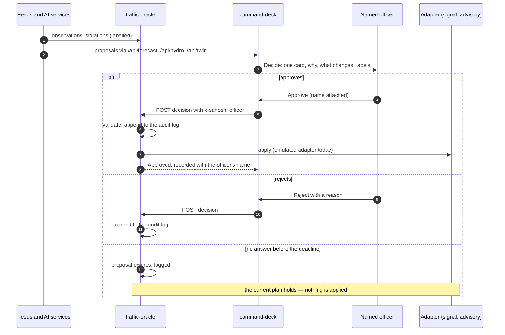

The server refuses a decision without a named officer (409 or 422; the deployed stack sets
`VVIP_REQUIRE_OFFICER=1`). Approve
controls exist only in Decide and the analyst workspace, never on the map, in the assistant or on public pages.

### 9.2 A field voice report

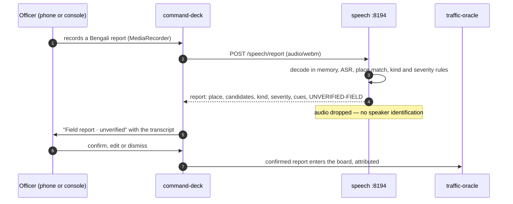

### 9.3 A waterlogging alert reaching citizens

1. hydro flags Rash Behari Avenue at class 2 with a 45-minute lead (MODELLED drivers shown).
2. The deck shows the reroute, ambulance-window and live-wire proposals and the advisory draft in Bengali and
   English.
3. An officer approves the advisory; it appears on `/citizen`, where the Listen button calls `/api/speech/speak`
   (allow-listed, rate-limited) and the audio is marked "synthetic voice".

### 9.4 The ambulance (108) corridor request

The crew taps one button on `/driver`; the request (rate-capped per client) becomes a PENDING dispatch for a named
duty officer; the crew sees the status. The crew always follows 108 control; Sahoshi claims no partnership with the
108 operator.

---

## 10. State machines

### 10.1 A proposal

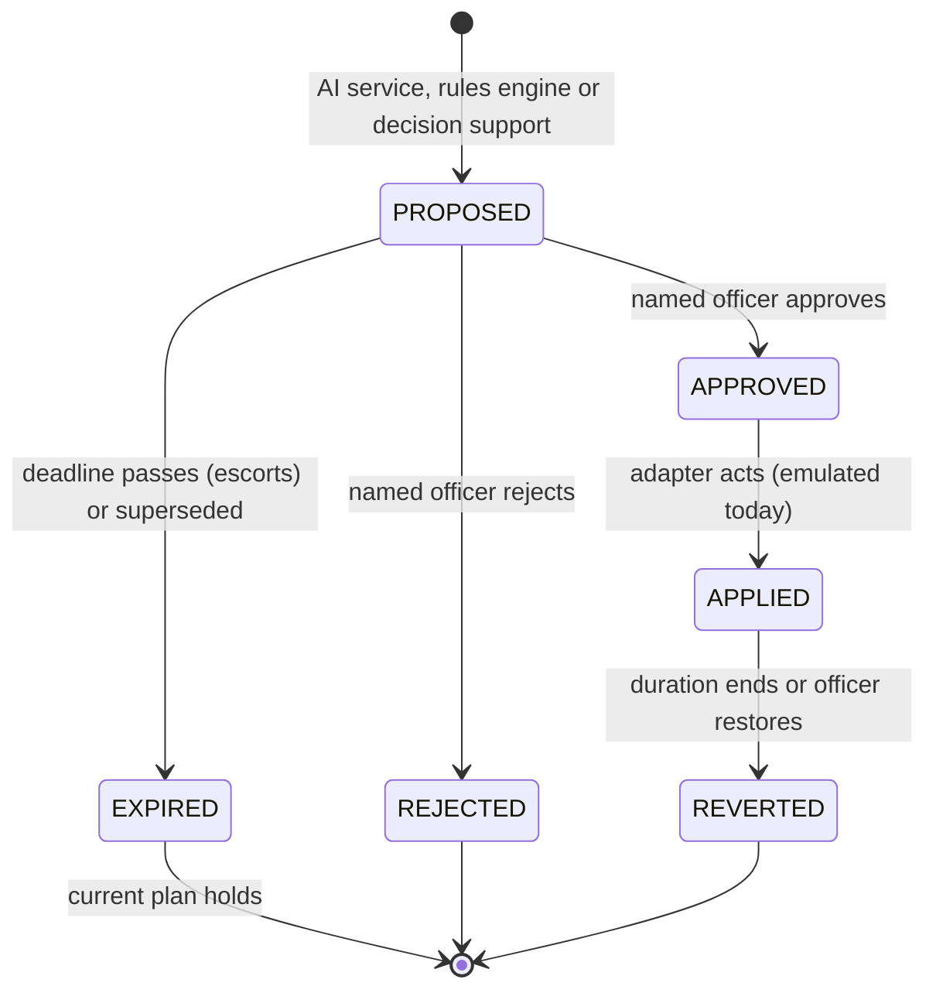

### 10.2 A corridor event

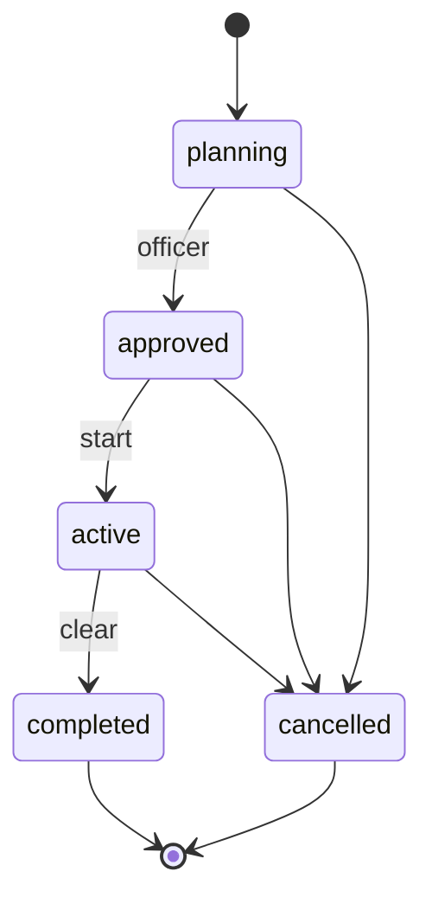

Every transition is written to `events.event_status_log` with its actor.

### 10.3 A field or camera reading

`UNVERIFIED-FIELD` / `UNVERIFIED-CAMERA` → confirmed by a named officer (enters the board as an event) or dismissed.
Neither state ever triggers an action by itself.

---

## 11. Security

### 11.1 Trust boundaries

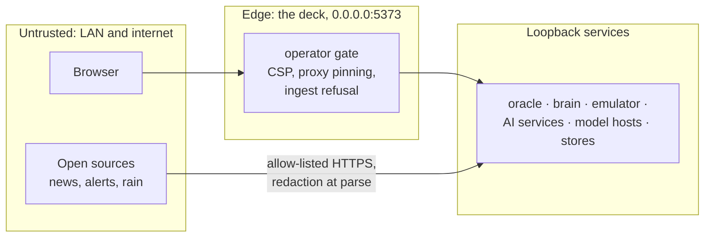

### 11.2 Operator gate

- Opt-in with `SAHOSHI_OPERATOR_PIN`. `POST /api/session` takes the officer's name and the PIN and sets a signed,
  HttpOnly session cookie (`SAHOSHI_SESSION_SECRET`; `SAHOSHI_SESSION_SECURE=1` behind TLS).
- Without the cookie, every proxied request is default-denied (403), decided on the canonical (once-decoded) path.
- Public exceptions: road geometry, liveness probes, the ambulance request (rate-capped), and for the AI services an
  allow-list: `GET` of the hydro nowcast, tide and rain (no forced refresh), and `POST /api/speech/speak` with a JSON
  body of at most 400 characters, at most 10 requests per client per minute. Transcription, field reports, vision,
  the twin, forecasts, the replay and every proposal need a signed-in officer.
- `sahoshi_up.sh --status` reports a deck on the LAN with the gate off as DEGRADED.

### 11.3 Officer attribution

Every decision carries the officer's name (`x-sahoshi-officer`), checked on loopback by the oracle and written to the
audit tables. "Naming yourself shows full registration marks on this console and records your name with the
decision. Attribution, not sign-in."

### 11.4 Content-security policy and headers

Nonce-based CSP per document: self, Google Fonts, OSM tiles and Cesium ion; `frame-ancestors 'none'`. Public pages
get no `eval` and no blob scripts; operator pages allow what Cesium needs. Every response: `nosniff`, a referrer
policy, `DENY` framing, and a permissions policy with no geolocation (the citizen page promises it collects no
location). The permissions policy allows the microphone for the deck's own origin only on the operator pages that
host the voice-report sheet; public pages deny it.

### 11.5 Network exposure

Only the deck binds the LAN. Every other service, model host and store binds 127.0.0.1. The deck's proxy targets
are fixed loopback hosts (only ports are configurable), and the upstream origin is re-checked after URL
construction. Outbound calls: Open-Meteo (hydro), allow-listed OSINT hosts (osint-ingress), and Cesium ion from the
officer's browser when a token is set. Model weights are never downloaded at run time.

### 11.6 Vehicles only, plate masking

- No person, face or biometric field exists in the schema. Camera sites store location and identity only.
- Plates are masked (`WB06EM•••1`) on every surface until a named officer is on duty; exports, share links and
  saved views are always masked. The oracle masks every label and feed text it sends; the deck masks everything it
  renders; both use the same rule (a test keeps them in parity).
- Vision refuses person and plate questions (403) and filters person sentences from its output.

### 11.7 Secrets

Secrets live only in `~/.config/sahoshi/sahoshi.env` (mode 600), set with `scripts/sahoshi_env.sh --set KEY -` so
the value never appears in argv or shell history. `scripts/secret_scan.sh` and a CI job scan the tree. No service
logs a secret. See [`ENVIRONMENT.md`](ENVIRONMENT.md).

### 11.8 Container hardening

The twin runs with a read-only root filesystem, every capability dropped, `no-new-privileges`, a non-root user and
a memory cap. The AI services have memory limits (forecast 6 GiB, hydro 512 MiB, speech 20 GiB, vision 1 GiB, twin
768 MiB) and rotated logs.

---

## 12. Privacy

Sahoshi is designed in the spirit of the Digital Personal Data Protection Act, 2023:

| Principle | In Sahoshi |
|---|---|
| Purpose limitation | Traffic, rain and crowd operations; no profiling of people |
| Data minimisation | Vehicles and places only; no faces; plates masked by default |
| Storage limitation | Watchlist retention capped at 90 days (schema CHECK); observations partitioned daily and dropped after 14 days; OSINT capture cache bounded (72 h or 200 MB) |
| Voice | Audio decoded in memory and dropped; only the transcript leaves the speech service, and it enters the board only when an officer confirms the report |
| Images | Processed in memory and re-encoded, which strips metadata; the vision service stores no image |
| OSINT | Aggregate only; names and ages redacted at parse; news and social URLs reduced to the outlet's domain and a hash |
| Citizens | Public pages collect no location and need no account |
| On premises | Data stays on the edge server; no cloud inference |

---

## 13. Reliability and degradation

- **Fail closed.** A missing officer, a failed shadow evaluation or an unreachable adapter never turns into an
  action. The adaptive engine falls back to baseline; the signal writer writes nothing.
- **Explicit degradation.** The oracle's guarded router registration answers 503 "not deployed" for a module that
  cannot import, and its degradation ledger lists every degraded path.
- **Models.** Lazy load, idle unload (forecast 600 s; speech and vision 10 minutes), memory floors (speech 12 GiB,
  vision 8 + 12 GiB) and 503 when a model cannot load. The forecast serves its baseline if the model breaks and says
  so; the twin uses a template when the LLM is busy or wrong; typed voice reports need no model.
- **Feeds.** hydro serves cached rain when rate-limited and runs offline (`SAHOSHI_HYDRO_OFFLINE=1`). OSINT parses its
  newest capture, labelled `cached-sample`, when a live fetch fails.
- **Connectivity.** Everything runs on one box; a cyclone that cuts the internet leaves the console, the models, the
  tide model and the twin working.
- **Boot.** `sahoshi.target` starts the stack at boot; `sahoshi_up.sh --boot` waits for Docker and converges.

---

## 14. Observability

| Signal | Where |
|---|---|
| Readiness | `scripts/sahoshi_up.sh --status` (one row per component and a security row) |
| Health | `GET /health` on every service; AI services report model slot, memory, labels and upstream reachability |
| Metrics | Prometheus `/metrics` on convoy-brain, model-host and llama-server |
| Audit | `events.event_status_log`, `events.enforcement_recommendations.audit_tail`, `corridor.signal_plan_log`, `decision.dss_decision_log`, `corridor.vehicle_lookup_audit`, the brain's decisions log |
| Degradation | `GET /api/v1/ops/degradation-taxonomy` |
| Logs | Docker json-file logs, rotated (10 MB × 3 for the twin); `SAHOSHI_LOG_DIR` for host units |
| NATS | Monitoring on `127.0.0.1:8233` (`/varz`, `/connz`) |

---

## 15. Deployment and capacity

### 15.1 Reference hardware

One NVIDIA GB10 edge server (arm64, 121 GiB unified memory) beside the control room. The platform services also run
on any x86-64 or arm64 machine with Docker; without the model hosts the brain falls back to its heuristic tier and
says so.

### 15.2 Memory budget (measured on the reference box)

| Process | Resident |
|---|---|
| Decider (model-host) | 49.0 GiB |
| Tactical LLM (llama-server, Gemma 4 12B Q4_K_M, 2 × 8k slots) | 7.3 GiB |
| Embeddings (pplx-embed + bge-m3) | ≈2.2 GiB |
| Platform services and stores | ≈12 GiB planned |
| Qwen3-VL-8B (vision, on demand) | 7.6 GiB |
| Speech ASR (on demand) / TTS (on demand) | ≈2.0 GiB / ≈4.8 GiB |
| Chronos-2 (on demand) | 1.6 GiB peak |

The on-demand models load lazily and unload when idle, so the box keeps headroom for the resident ones.

### 15.3 Scaling

- **More cities:** a new City Pack and a build (§6); one box per city or district control room.
- **More load:** the deck is stateless behind its proxy and can be replicated; the oracle is the single writer to
  the store; the AI services are independent processes that can move to a second box (their URLs are settings).
- **Pilot costs** and the next packs are in [`../PRODUCT.md`](../PRODUCT.md).

---

## 16. Testing strategy

| Level | What | Count (28 Oct 2026) |
|---|---|---|
| Unit and API (Python) | Every service, offline, outbound calls mocked | 5,921 passed |
| Real-model (opt-in) | forecast `-m model`, speech and vision `-m slow` | run on the box with weights |
| Rust | signal-ingress | 121 passed |
| Deck | `svelte-check`, design-token and copy lints, Bengali-script check, 42 unit suites, contract replay, proxy guard | see [`SAMPLE_DATA_AND_TESTS.md`](SAMPLE_DATA_AND_TESTS.md) |
| City Pack | `city_build.py --check`; a test builds two cities | pass |
| Browser smokes and journeys | Screens against a running stack | on demand |
| Acceptance ladder | `scripts/verify_all.sh` (offline) and `--live` | on demand |

Principles: an ethics rule is tested as behaviour (a 409, a 403, a refusal before the model call), never only as
copy; tests that need a live service or a model are opt-in and say so; a test that hard-codes city facts reads them
from the City Pack.

---

## 17. Architecture decision records

Each record states the context, the decision and its consequences.

### ADR-01 — All AI runs on premises

- **Context.** City operations data (traffic, plates, officer decisions) should stay with the city, and Kolkata
  loses connectivity in cyclones (Amphan 2020, Remal 2024, Dana 2024).
- **Decision.** Every model runs on one edge server beside the control room; no cloud inference; weights are fetched
  once at install and served with `HF_HUB_OFFLINE=1`.
- **Consequences.** No per-call fees and no data egress; the console works offline. Model choice is bounded by one
  box's memory (§15.2), so models are small or quantized and load on demand.

### ADR-02 — The City Pack: a city is a folder

- **Context.** The platform was first built for another city, and city facts ran through the whole codebase.
- **Decision.** Move everything city-specific into `cities/<id>/` and generate every derived file with
  `scripts/city_build.py`, deterministically and offline, with a `--check` mode.
- **Consequences.** A new district is a new folder and a build; a test builds two packs; drift between the pack and
  the services is caught by `--check`.

### ADR-03 — Chronos-2 zero-shot instead of training a model

- **Context.** There is no recorded Kolkata traffic history to train on yet.
- **Decision.** Use Chronos-2, a zero-shot, covariate-aware foundation model (Apache-2.0), with TimesFM 2.5 as a
  challenger and a seasonal-naive baseline beside every forecast; label everything "forecast on simulated traffic"
  until real history exists.
- **Consequences.** Forecasts from day one with honest labels and a backtest; when history accumulates, the same
  pipeline reads it (`data_source=auto`). A trained model can be added later as another contender.

### ADR-04 — Test every signal change in a twin before an officer sees it

- **Context.** "Give the busy road more green" often moves the queue to the cross street or the next junction.
- **Decision.** Every signal-timing proposal is simulated over the whole network in a cell-transmission model
  against doing nothing, with guards (network delay, cross street, spill-back, minimum gain), a sensitivity check
  and a confidence; the twin has no client for the signal writer.
- **Consequences.** Proposals arrive with their modelled side effects; "hold" is a valid answer. Macroscopic
  limits (PCU, assumed turning ratios, template programs) are stated in each proposal.

### ADR-05 — The LLM words, it never decides timings or numbers

- **Context.** A language model can invent numbers.
- **Decision.** The twin and the ranking choose; the LLM writes a short rationale in English and Bengali, and a
  validator rejects any number not in the twin metrics and any Bengali with stray Latin or another script, falling
  back to a template.
- **Consequences.** Rationales are readable and safe; the validator checks numbers and script, not meaning.

### ADR-06 — Bengali first

- **Context.** Most residents, and many field officers, work in Bengali.
- **Decision.** UI languages `bn`, `en`, `hi`; public pages default to Bengali; Noto Sans Bengali self-hosted; voice
  reports in Bengali; advisories read aloud in Bengali; a Bengali-script lint on every pack; place matching across
  scripts.
- **Consequences.** Every string exists three times and the lint enforces parity; a native read is still advised
  before a pilot.

### ADR-07 — Emulated adapters with honest labels

- **Context.** FFEWS, CCTV and signal-controller access are not public.
- **Decision.** Build each integration as an adapter interface with an emulated implementation that labels every
  record EMULATED; the pilot plan names the access each one needs.
- **Consequences.** The full flow can be shown and tested today without pretending; swapping in a real feed changes
  one class.

### ADR-08 — Vehicles-only vision

- **Context.** A general vision-language model will describe people if asked.
- **Decision.** Constrain Qwen3-VL to road states with a JSON schema, refuse person and plate questions before the
  model is called (403), and filter person sentences from its output; depth bands are judged against vehicles and
  kerbs, never a person's body.
- **Consequences.** The guarantee holds even if the model ignores its prompt (tested on real unguarded output). The
  person filter works on English text, so the model is instructed to answer in English.

### ADR-09 — The AI proposes; a named officer decides; no answer means the plan holds

- **Context.** Automated actions on roads affect lakhs of people and must be accountable.
- **Decision.** Every AI output is a proposal (`requires_officer: true`); the server refuses unnamed decisions;
  time-boxed proposals expire to "the current plan holds"; the assistant's tools cannot approve.
- **Consequences.** Slower than full automation by design; every action has a name in the audit log.

### ADR-10 — Loopback-only services behind one deck proxy

- **Context.** Several services can write city state.
- **Decision.** Only the deck binds the LAN; it proxies fixed loopback targets, pins the upstream origin, refuses
  machine-ingest paths from browsers, and applies the operator gate and an allow-list for public AI reads.
- **Consequences.** One place to audit exposure; the deck must be the only route for browsers (tested by
  `no-live-port`).

### ADR-11 — A conceptual ponding model for waterlogging, not a sewer model

- **Context.** KMC's drain network data is not public, and a nowcast must run every few minutes on the CPU.
- **Decision.** A bucket model per segment with stated parameters, drainage capacity bounded by public statements,
  driven by rain, the tide and pump state, with terrain susceptibility from open data; validated against the 2025
  storm reports.
- **Consequences.** Explainable and fast; not calibrated beyond one event; a hydraulic model (for example SWMM) can
  replace it when KMC data is available.

### ADR-12 — Open models with a measured choice and a documented fallback

- **Context.** The first-choice Bengali models (IndicConformer, Indic Parler-TTS) are gated.
- **Decision.** Measure open checkpoints on the same audio and pick the best (a Bengali Whisper-medium fine-tune,
  CER 2.6 %); Svara-TTS for bn/hi/en; keep the gated models as preferred once access is granted, behind the same
  interfaces.
- **Consequences.** Working Bengali voice now, with an upgrade path that changes no API.

### ADR-13 — llama.cpp for the vision model and TTS

- **Context.** The edge server is arm64 and shared with resident models.
- **Decision.** Run Qwen3-VL-8B (Q4_K_M) and Svara-TTS (Q8_0) on `llama-server`, started on demand on loopback,
  stopped when idle, refused below a memory floor.
- **Consequences.** No heavy Python ML stack in the vision service; schema-constrained decoding; TTS about 2.4× faster
  than transformers on the box.

### ADR-14 — One PostGIS store as the system of record

- **Context.** Events, routes, decisions and audit must be consistent and spatial.
- **Decision.** PostgreSQL 16 with PostGIS, pgRouting and pgvector; the oracle is the single writer; additive,
  ledgered migrations.
- **Consequences.** Simple operations and one backup; the AI services stay stateless.

### ADR-15 — A tide model from cited constants instead of an unavailable table

- **Context.** The Garden Reach harmonic constants are in the Survey of India tables, which are not online.
- **Decision.** Transfer cited Diamond Harbour constants to Garden Reach with a fitted lag, ratio and M4 term, check
  against published predictions and the reported 2025 gate closure, and label it MODELLED (approximate).
- **Consequences.** A usable gate-closure signal now; replace with the official constants or a gauge feed in a pilot.

---

## 18. Known limitations

- Traffic is simulated until the oracle receives a real Kolkata feed; forecasts and twin demand say so.
- Rain is a model nowcast; the 2025 replay shows gridded products can miss a convective night. A gauge feed (KMC
  FFEWS or IMD AWS) is the pilot's first need.
- Pumps, signal controllers and CCTV are emulated or not connected.
- The road network covers 65 arterial segments; many reported waterlogging places are off it.
- Speech was evaluated on synthetic audio; vision on 12 photos. Real field sets are needed before a pilot.
- The twin is macroscopic with assumed turning ratios and template programs.
- The regional SAR flood-extent layer (Prithvi-EO-2.0 on Sentinel-1) is planned, not built.
